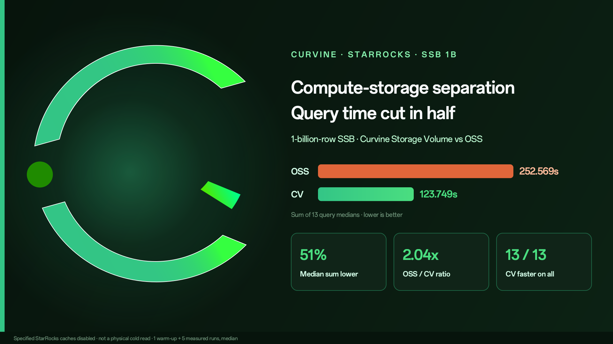
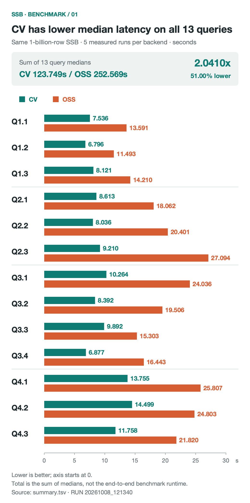
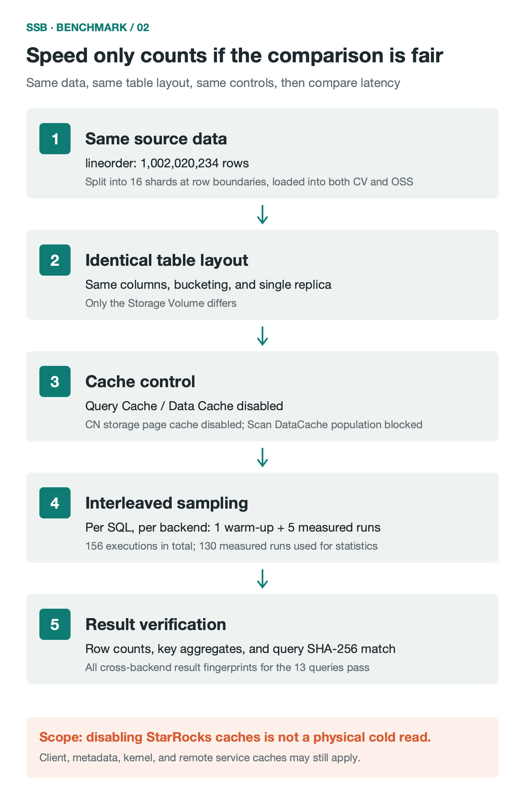

> On one StarRocks compute-storage separation cluster, the same 1-billion-row SSB dataset was placed on a Curvine Storage Volume and on OSS. With the specified StarRocks caches turned off, Curvine had a lower median latency on all 13 queries. The sum of the 13 medians fell from 252.569 seconds to 123.749 seconds, a 51% reduction.

<!-- truncate -->

With compute and storage separated, data lives in object storage. Compute nodes can scale on demand, and storage costs less. The trade-off is that every scan reads remotely. OSS/S3 access latency and throughput limits show up directly in query time.

We wanted to know how much an analytics query improves when Curvine sits between StarRocks and object storage. This round uses the Star Schema Benchmark (SSB). Below are the method, the results, and the integration config.

In this article, CV means Curvine Storage Volume. OSS means using object storage directly as the Storage Volume.

## 1. Test results

SSB has 13 standard queries (Q1.1–Q4.3), covering multi-dimensional filters, multi-table joins, and aggregation. Each query runs 1 warm-up and 5 measured runs on each backend. The reported number is the median of the 5 measured runs.



Figure 1: Median of 5 measured runs on each backend. Warm-up is excluded. Unit is seconds. Lower is better.

The numbers:

| Query | CV (seconds) | OSS (seconds) | Reduction |
| --- | ---: | ---: | ---: |
| Q1.1 | 7.536 | 13.591 | 44.55% |
| Q1.2 | 6.796 | 11.493 | 40.87% |
| Q1.3 | 8.121 | 14.210 | 42.85% |
| Q2.1 | 8.613 | 18.062 | 52.31% |
| Q2.2 | 8.036 | 20.401 | 60.61% |
| Q2.3 | 9.210 | 27.094 | 66.01% |
| Q3.1 | 10.264 | 24.036 | 57.30% |
| Q3.2 | 8.392 | 19.506 | 56.98% |
| Q3.3 | 9.892 | 15.303 | 35.36% |
| Q3.4 | 6.877 | 16.443 | 58.18% |
| Q4.1 | 13.755 | 25.807 | 46.70% |
| Q4.2 | 14.499 | 24.803 | 41.54% |
| Q4.3 | 11.758 | 21.820 | 46.11% |
| Sum of medians | 123.749 | 252.569 | 51.00% |

A few conclusions:

1. On all 13 queries, the CV median latency is lower than OSS.
2. Summing the 13 medians, OSS is 252.569 seconds and CV is 123.749 seconds. OSS / CV is 2.04×.
3. The largest reduction is Q2.3, from 27.094 seconds to 9.210 seconds, down 66.01%.
4. The smallest reduction is Q3.3, at 35.36%.

"Sum of medians" adds the median of each of the 13 queries. It is for an overall comparison. It is not the wall-clock time of the whole test.

## 2. How the test was run

Storage comparisons are easy to distort with different data, different table layouts, or cache. This run controlled five things: data, table layout, cache, sample order, and result checks.



Figure 2: Test flow. 156 executions include 26 warm-ups and 130 measured runs. Only measured samples are included in the statistics.

### 1. Data size and load

The SSB fact table `lineorder` has 1,002,020,234 rows. The raw data file is 105 GB. The full database is about 1.008 billion rows.

The data was split into 16 shards on complete row boundaries and loaded into CV and OSS with Stream Load. Both sides loaded the same number of rows, and filtered rows were 0 on both. After the load, `COUNT(*)`, `SUM(lo_orderkey)`, `SUM(lo_revenue)`, and `SUM(lo_supplycost)` matched.

This check covers row counts and key aggregates. It is not a row-by-row or byte-by-byte comparison.

### 2. Table layout

Both sides use the same columns, bucketing, and single-replica settings. The only difference is the Storage Volume.

### 3. Cache control

To push queries down to the storage layer, the test turned off these StarRocks caches:

- `enable_query_cache = false`: turn off Query Cache
- `enable_scan_datacache = false` and `datacache.enable = false`: turn off scan and table-level Data Cache
- `populate_datacache_mode = 'never'`: do not populate Data Cache
- `disable_storage_page_cache = true`: turn off the storage page cache on CN nodes

These settings cover only StarRocks' own caches. Client, metadata, JVM, OS kernel, and remote server caches may still be present, so these results should not be read as physical cold-read performance.

### 4. Sampling

Each query runs 1 warm-up and 5 measured runs on each backend. 13 queries make 156 executions: 26 warm-ups and 130 measured runs. CV and OSS run alternately, so a fixed order does not bias the result.

### 5. Result checks

Every one of the 156 executions has a SHA-256 fingerprint of the query result. Fingerprints match across all rounds and both backends, so both sides returned the same results.

## 3. Where the performance difference comes from

The compute cluster, table layout, SQL, and query settings are the same. The difference comes only from the storage layer. From Curvine's architecture and the query Profile, the main reasons are these.

### 1. Data sits closer to compute

A direct OSS read issues a remote HTTP request on every scan, limited by network bandwidth and connection setup.

Curvine uses a Master–Worker architecture. Workers can run on the CN node or on a neighboring node, with memory, NVMe SSD, and HDD as a multi-level cache. After a columnar file is loaded once, it stays on local media. Later reads are local or LAN reads. Latency and throughput are steadier than remote object storage.

### 2. Async I/O with Rust and Tokio

Curvine's core is written in Rust on the Tokio async runtime. There is no GC pause, runtime overhead is small, and zero-copy transfer keeps CPU use low under highly concurrent reads. Multi-table joins such as Q2.3 and Q4.1 issue many reads at once, and that overhead shows up in latency.

### 3. A read path built for scans

Curvine provides a POSIX FUSE interface and a client SDK. The read path uses read-ahead and a concurrent reader-handle pool (ReaderPool), so threads reading the same file do not queue behind each other.

On the Q4.1 Profile, columnar segment init (`SegmentInit` / `ColumnFileOpen`) is faster on CV, sequential read throughput is higher, and `IOTime` for large-table scans is clearly lower than on OSS.

### 4. Metadata access

Cluster metadata is managed with Raft. When many columnar files are scanned concurrently, the metadata cache and parallel lookup cut the time to open files and resolve metadata, which reduces the effect of long-tail requests.

## 4. How StarRocks connects to Curvine

### 1. Access path

StarRocks reaches Curvine through the Hadoop-compatible FileSystem interface. Put the Curvine Hadoop client JAR on the CN nodes, and register `io.curvine.CurvineFileSystem` and `io.curvine.CurvineAbstractFileSystem` in `core-site.xml`. StarRocks can then read and write Curvine with the `cv://` scheme.

Metadata requests go to the Master over RPC. Data reads and writes go to Workers.

### 2. Two mount modes

When Curvine mounts underlying storage (UFS), there are two modes. Which one to use depends on the workload.

**cache_mode (cache mode)**

Curvine is a distributed cache in front of OSS/S3. Reads check the local multi-level cache first and fetch from the source on a miss. Writes do not require strict synchronization.

This fits read-heavy workloads where the data is already in object storage and you want NVMe to raise read performance.

**fs_mode (filesystem mode)**

Curvine is the primary store. A background journal-based export keeps it in sync with UFS. Reads support consistency checks and fallback. Writes land on Curvine first, then persist to UFS.

This fits a StarRocks Storage Volume: a separated warehouse with frequent reads and writes, multi-dimensional analysis, and data loading.

### 3. Configuration steps

**Step 1: Mount object storage**

Use `cv mount` to mount OSS under the Curvine namespace `/my-hdfs/starrocks`:

```bash
bin/cv mount "oss://my-hdfs/starrocks/" "/my-hdfs/starrocks" \
  --provider oss \
  --config oss.endpoint=cn-beijing.oss-dls.aliyuncs.com \
  --config oss.accessKeyId=YOUR_ACCESS_KEY_ID \
  --config oss.accessKeySecret=YOUR_ACCESS_KEY_SECRET
```

**Step 2: Deploy the client JAR**

Place the Curvine Hadoop client JAR (for example `curvine-hadoop-0.2.0-shade.jar`) in the Hadoop dependency directory on every CN node.

**Step 3: Configure core-site.xml**

Register the driver in the Hadoop config StarRocks uses (for example `hadoop-conf/core-site.xml`) and set the Master addresses. The cluster id here is `curvine-pro`:

```xml
<configuration>
    <!-- Curvine FileSystem implementation -->
    <property>
        <name>fs.cv.impl</name>
        <value>io.curvine.CurvineFileSystem</value>
    </property>
    <!-- Curvine AbstractFileSystem implementation -->
    <property>
        <name>fs.AbstractFileSystem.cv.impl</name>
        <value>io.curvine.CurvineAbstractFileSystem</value>
    </property>
    <!-- Master addresses for cluster curvine-pro, the authority in cv://curvine-pro/... -->
    <property>
        <name>fs.cv.curvine-pro.master_addrs</name>
        <value>master-0:8995,master-1:8995,master-2:8995</value>
    </property>
</configuration>
```

**Step 4: Create the Storage Volume**

After restarting the related services, create the Storage Volume in StarRocks:

```sql
CREATE STORAGE VOLUME sr_cv_volume
TYPE = HDFS
LOCATIONS = (
  'cv://curvine-pro/my-hdfs/starrocks/'
)
PROPERTIES (
  "enabled" = "true"
);
```

A few notes:

- `TYPE = HDFS` means access through the Hadoop FileSystem-compatible interface.
- `curvine-pro` in `cv://curvine-pro/...` must match the cluster id in `fs.cv.<cluster_name>.master_addrs` in `core-site.xml`. StarRocks uses that id to find the Master addresses.
- The path must match the namespace mounted in step 1.

## 5. Summary

This test used the same StarRocks cluster, the same data, and the same table layout, with StarRocks' own caches turned off. With a Curvine Storage Volume, the sum of medians across the 13 SSB queries dropped by 51%, and every query was faster than reading OSS directly.

The boundary of the test is stated here: the results do not represent physical cold-read performance, and this run did not evaluate differences in storage cost or elastic scaling.

Curvine source and docs are on GitHub: https://github.com/curvineio/curvine
