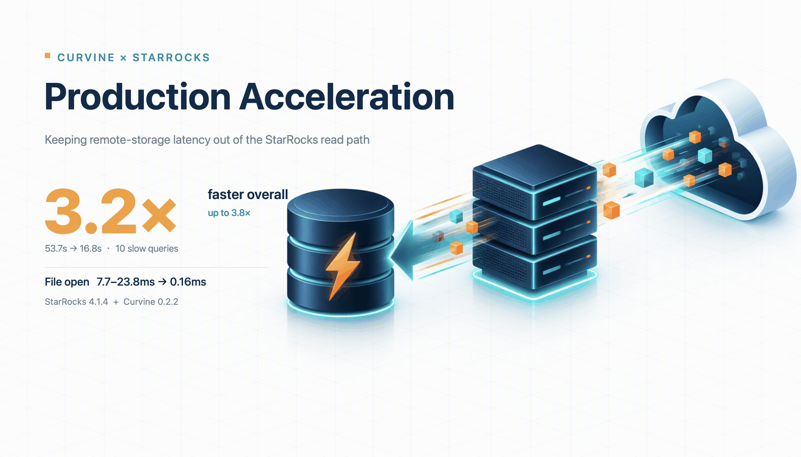
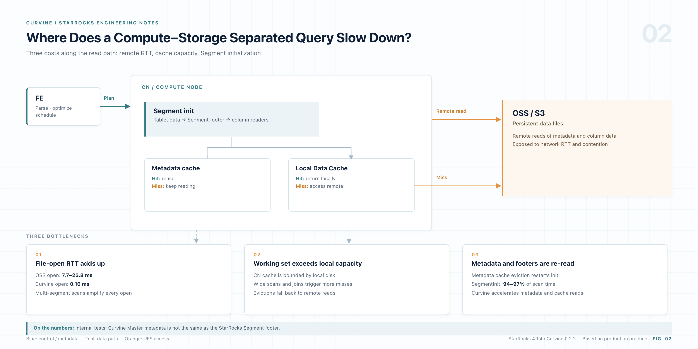
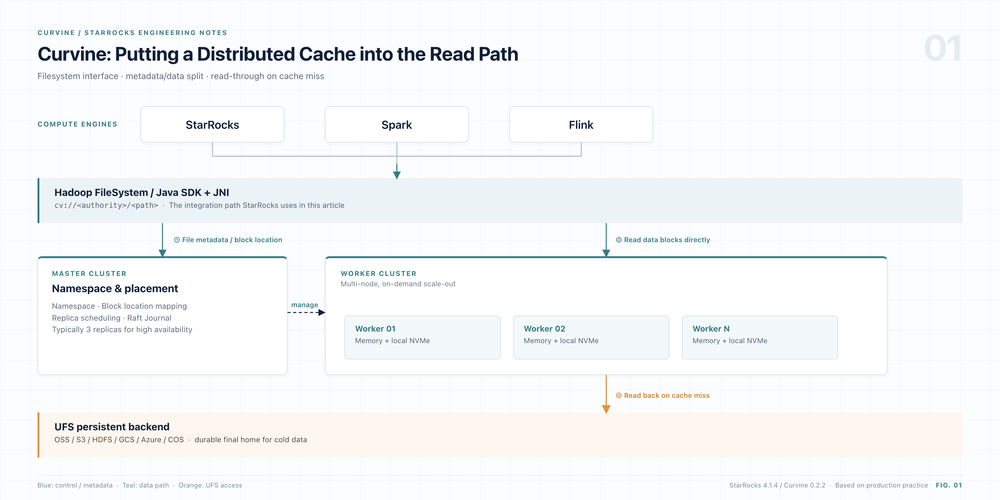
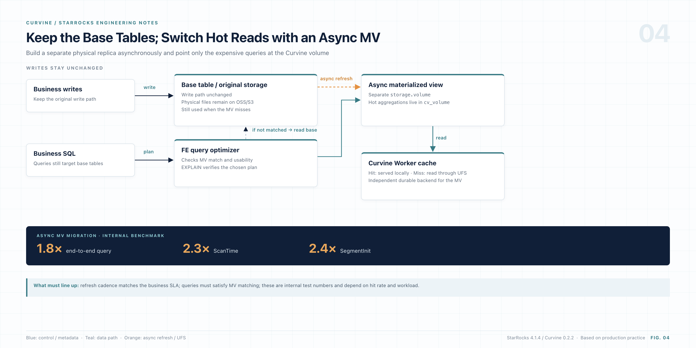
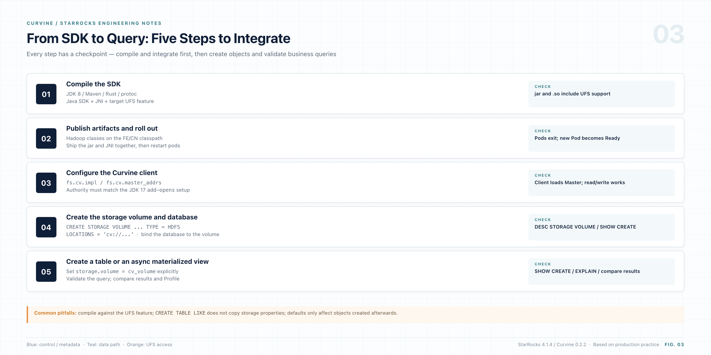

> Results first: after moving the data from object storage to Curvine, ten production slow queries dropped from **53.7s** to **16.8s**, a **3.2×** overall speedup and up to **3.8×** for a single query. Single-file open fell from **7.7–23.8ms** to **0.16ms**. Not a line of SQL changed, and StarRocks was not forked. For base tables that cannot be migrated, an async materialized view on Curvine still delivered **1.8×** end-to-end and **2.4×** on SegmentInit.

<!-- truncate -->

| Metric | Result |
| --- | --- |
| Total runtime of 10 production slow queries | 53.7 s → **16.8 s** |
| Overall speedup | **3.2×** |
| Peak single-query speedup | **3.8×** |
| Stable speedup range | 7 queries between **3.4–3.8×** |
| Single-file open latency | 7.7–23.8 ms → **0.16 ms** |

*Test environment: StarRocks 4.1.4 + Curvine 0.2.2. Data comes from internal production-cluster tests; actual gains depend on query workload and cache hit rate.*

If you work on big data or OLAP architecture, you have probably evaluated or adopted compute-storage separation over the past few years. The pitch is compelling: put hot and cold data in object storage, lower storage cost, scale compute elastically, and stop reserving expensive local-disk instances for peak hours.

That is the ideal. But once the system takes on complex production analytics, many teams run into a counterintuitive problem:

**The data sits in an object-storage tier marketed as a "high-performance storage pool," and a local cache is enabled. So why do complex aggregations and joins still suddenly become slow?**

When we investigated in production, the bottleneck was usually not throughput or bandwidth. It came from three easy-to-miss hidden costs: **expensive network round-trips, a hard ceiling on local cache capacity, and repeated reads of Segment metadata**.

This article walks through how we identified those three costs and rolled out Curvine in a real production environment.

---

## 1. Compute-storage separation: the ideal and the reality

In StarRocks compute-storage separation, the FE handles metadata, query parsing, and scheduling. CN nodes are stateless compute nodes that can scale elastically. Data files live in remote object storage, and each CN node relies on a local Data Cache for read caching.

This architecture solves "compute elasticity" beautifully, but it pushes all runtime cost onto the data read path. When we run analytical queries against object storage, three physical bottlenecks are unavoidable.

## 2. Where the query time goes: three hidden costs



*Figure: The StarRocks compute-storage-separation read path and its three hidden costs*

### 2.1 Opening a file is a thousand times slower than reading it

Performance tuning intuition can mislead you. Many people assume a slow query is spending time downloading tens or hundreds of megabytes from object storage. But when we captured flame graphs and detailed traces on slow-query nodes, the result was surprising:

- On object storage, a single Segment file open costs **7.7–23.8 ms** in network and handshake overhead.
- In contrast, the subsequent local I/O to read a columnar data block may cost only **9.994 µs**.

In other words, the simple act of "opening a file handle" is **three orders of magnitude** slower than reading the data itself. After switching to Curvine in production, a single-file open took only **0.16 ms**.

The bottleneck is not the internal network bandwidth. It is the network round-trip and handshake latency that every HTTP/REST request to remote storage must pay. If a large query touches hundreds of shards, just opening the files one by one can quietly burn dozens of seconds.

> Note: the 0.16 ms figure is the time for the Curvine Master to deliver file metadata. It is not strictly equivalent to a StarRocks Segment footer read; it is used here only to illustrate the order-of-magnitude difference.

### 2.2 The local Data Cache cannot absorb the working set

You may ask: doesn't a CN node already have a Data Cache? If the local cache hits, doesn't that bypass object storage?

The idea sounds good, but local disk capacity has a hard limit. The Data Cache is bounded by `datacache_disk_size` and by the hardware configuration of the CN node.

For point lookups or narrow scans that touch tens of thousands of rows, the local cache is usually enough. But once a business query starts a wide time-range scan, or joins several tens-of-millions-row tables, the working set immediately blows out the cache.

When the cache is breached, the query falls back to remote storage. The worst part is how **silent** this degradation is: a small single-table test looks fast offline, while a wide-table heavy query at the morning peak becomes several times slower.

### 2.3 The overlooked culprit: SegmentInit and metadata thrashing

If the first two costs were expected, the third one only surfaced when we dug into query profiles.

Across multiple tens-of-millions-row queries, we saw a strikingly consistent pattern: **`SegmentInit` accounted for 94%–97% of total scan time (ScanTime)**. Most of the Scan phase was not decompressing data or evaluating projections. It was repeatedly opening Segments and parsing footer information.

Why? Reading the StarRocks source made the chain obvious:

1. **Every cold Segment open must fetch tail metadata.** To read a Segment, the query engine makes at least two remote calls: first read `<tablet>_<version>.meta`, then fetch the 16 KB footer. The `load_segment` implementation in StarRocks even carries this comment:

   ```cpp
   // segment->open will read the footer, and it is time-consuming
   ```

2. **The CN's internal metadata cache is capped at 2 GB and cannot grow.** In the code, `lake_metadata_cache_limit` is hard-coded to `2147483648` (2 GiB). Once a production cluster has a few more tables or partitions, this fixed-size pool stays full. Under memory pressure, LRU can only keep evicting old metadata. **Misses become the norm.**

That produces a brutal equation:

> **Query overhead = number of Segments × per-Segment metadata access latency**

When a heavy query covers hundreds or thousands of Segments, the columnar data blocks may already be sitting in the local Data Cache. Yet to "confirm the metadata," the engine still has to issue thousands of remote file-metadata fetches.

All three hidden costs point to the same fix: **pull file abstractions and hot data from the far side to the near side.**

---

## 3. What role does Curvine play?

Curvine is our open-source distributed cache filesystem built in Rust. Architecturally, it makes a neat substitution:

- **Upward**, it exposes the standard Hadoop `FileSystem` interface through the `cv://` scheme.
- **Downward**, it delegates durable storage to the existing underlay (UFS), such as public-cloud OSS/S3 or an internal HDFS.



*Figure: Curvine puts a distributed cache into the read path, compatible with Hadoop above and UFS below*

The core components:

| Component | Responsibility |
| --- | --- |
| Master (typically 3 replicas) | Manages the file namespace, Block location mapping, replica scheduling, and Raft Journal state persistence |
| Worker (multi-node, scale-out) | Stores data blocks and serves high-speed reads/writes; maintains a two-tier cache in memory and local NVMe |
| UFS backend | Final home for cold data; supports OSS / S3 / HDFS / GCS / Azure / COS / WebHDFS |

For the engine layer, the best part is **ecosystem transparency**: Curvine looks like a standard storage volume, so StarRocks can integrate without a source-code fork.

Curvine's architecture maps directly to the three problems:

| Object-storage pain point | Curvine mechanism | Production validation |
| --- | --- | --- |
| Expensive network round-trips | Hot data lands on Worker-local NVMe; the read path never touches the remote network | Single open reduced from 7.7–23.8 ms to **0.16 ms** |
| Local Data Cache capacity ceiling | The cache becomes a cluster-wide pooled layer that scales with Worker nodes | The cache pool scales linearly; large working sets no longer breach it easily |
| Frequent metadata fetches | File metadata is delivered by the Curvine Master over internal RPC, avoiding inefficient LIST/HEAD and repeated HTTP requests | SegmentInit time reduced by **2.4×** |

One metadata difference deserves a closer look.

StarRocks' 2 GB metadata cache is private to each CN node; once it overflows, entries are evicted. Curvine moves metadata into the Master, independent of any single compute node. **This is a storage-topology decoupling, not something you can catch up to by tweaking a few StarRocks configuration knobs.**

---

## 4. Production results: real slow queries

To validate the gain, we did not use a standard benchmark suite. We pulled the top 10 slowest real queries from the production audit log.

All 10 are heavy queries over tens of millions of rows, with multi-table joins and complex aggregations—exactly the workload that exposes underlying I/O differences. After migrating the data to Curvine, we replayed each query under the same load (time in seconds):

| # | OSS | Curvine | Speedup |
| --- | --- | --- | --- |
| 01 | 6.322 | 1.693 | 3.7× |
| 02 | 6.149 | 1.653 | 3.7× |
| 03 | 6.094 | 1.669 | 3.7× |
| 04 | 6.454 | 1.923 | 3.4× |
| 05 | 6.129 | 1.661 | 3.7× |
| 06 | 6.543 | 1.894 | 3.5× |
| 07 | 7.425 | 2.727 | 2.7× |
| 08 | 1.249 | 1.119 | 1.1× |
| 09 | 0.863 | 0.782 | 1.1× |
| 10 | 6.487 | 1.726 | 3.8× |
| **Total** | **53.7** | **16.8** | **3.2×** |

Total runtime fell from **53.7 s to 16.8 s**, a **3.2×** overall speedup. Seven of the ten queries landed in the **3.4–3.8×** range.

Why is the gain so large? Because **small per-open savings compound**. A heavy SQL statement fans out into thousands of concurrent Segment opens. On remote object storage, just opening the files can take seconds; with Curvine's millisecond-level opens, I/O preparation time becomes nearly negligible.

---

## 5. Cannot move the base table? Use an async materialized view

In production, core base tables are enormous and receive real-time writes every second. Taking them offline, or migrating them wholesale to a new storage volume, is usually not an option.

For this "base table cannot move, but performance must improve" situation, we found a low-intrusion workaround: **build an async materialized view on a Curvine storage volume**.

The base table stays on its original OSS/S3 volume and keeps ingesting writes. The materialized view's physical files are placed directly on the Curvine volume. When StarRocks' transparent rewrite engine detects a matching aggregate query, it routes the query to the materialized view. In other words, **not a single line of business SQL changes, yet the read path quietly switches to Curvine's high-speed link.**



*Figure: The base table stays on its original volume while an async materialized view moves hot reads to Curvine*

We migrated the largest async materialized view in the business to a Curvine storage volume. The measured gains were striking:

| Metric | Improvement vs. original remote volume |
| --- | --- |
| End-to-end query time (median) | **1.8×** faster |
| ScanTime | About **2.3×** faster |
| SegmentInit | About **2.4×** faster |

Notice where the gain concentrates: the largest improvement is in `SegmentInit`. This matches the earlier diagnosis—once the data range narrows, metadata addressing becomes the biggest burden, and Curvine targets exactly that.

The core DDL:

```sql
CREATE MATERIALIZED VIEW my_db.mv_on_cv
DISTRIBUTED BY HASH(user_id) BUCKETS 9
REFRESH MANUAL                              -- Trigger manually at first to avoid peak hours
PROPERTIES (
    "replication_num" = "1",
    "storage_volume" = "cv_volume"          -- Key: place MV physical files on the CV volume
)
AS
SELECT
    dt,
    user_id,
    count(1) AS pv,
    sum(price) AS total_gmv
FROM oss_db.huge_base_table
GROUP BY dt, user_id;
```

Key mechanics worth remembering:

- Async materialized views **fully support the `storage_volume` property**; this behavior has been validated repeatedly in production.
- The default rule is clear: if the property is omitted, the MV inherits the default volume of its database. It **never wrongly inherits the base table's storage volume**.
- A regular logical view (`CREATE VIEW`) is only a SQL macro with no physical entity, so it does not support or honor the property.
- After creation, run `REFRESH MATERIALIZED VIEW ... WITH SYNC MODE` for a one-off materialization; it usually finishes in tens of seconds. Subsequent aggregate queries transparently hit the fast path.

---

## 6. Rollout: from build to query, with the pitfalls

With the principle and the results in hand, here is how to roll it out. We ran this process end-to-end multiple times across test and production clusters. **Follow the order. Skip a validation step and you will almost certainly have to start over.**



*Figure: The five-step integration flow, with an acceptance check at every step*

### 6.1 Choose the right mode: `fs_mode` vs. `cache_mode`

When connecting StarRocks to Curvine, distinguish the client access pattern from the underlying UFS mount/write mode:

- **`cache_mode` (cache mode)**: Focused on "read acceleration with lightweight caching." Curvine acts as a high-performance distributed cache in front of object storage (OSS/S3). Reads check the tiered local cache (memory/NVMe SSD) first and fall back transparently on a miss; writes do not require strict synchronization. Use it for read-heavy workloads where the data already lives in object storage and the goal is NVMe read acceleration.
- **`fs_mode` (filesystem/storage-volume mode)**: Focused on an "independent filesystem with a strongly consistent storage volume." Curvine acts as the primary or full-featured storage volume, keeping lifecycle in sync with the underlying UFS through a journal-driven export mechanism. Reads support consistency checks and fallback; writes land in Curvine first and are persisted to UFS, preserving durability. Use it for StarRocks-like compute-storage-separation warehouses that need high-frequency writes, multi-dimensional analytics, and data ingestion on the primary volume.

Mount remote object storage in Curvine (`cv mount`):

```bash
bin/cv mount "oss://my-hdfs/starrocks/" "/my-hdfs/starrocks" \
  --provider oss \
  --config oss.endpoint=cn-beijing.oss-dls.aliyuncs.com \
  --config oss.accessKeyId=YOUR_ACCESS_KEY_ID \
  --config oss.accessKeySecret=YOUR_ACCESS_KEY_SECRET
```

### 6.2 Get the source

```bash
git clone https://github.com/CurvineIO/curvine curvine
cd curvine
```

### 6.3 Build the Java SDK

The first step is to build the Java SDK and the underlying JNI library used by StarRocks FE/CN.

Requirements:

- JDK 8 (for the build)
- Maven ≥ 3.8.1
- A complete Rust toolchain (Cargo)
- The `protoc` compiler

```bash
# Build the client with OSS support
make build ARGS='--package java --ufs oss'
```

The build produces two key artifacts:

| Artifact | Purpose |
| --- | --- |
| `curvine-hadoop-*.jar` | Java SDK interface used by the upper layer |
| `libcurvine_libsdk_<os>_<arch>_64.so` | Rust JNI native library |

One detail matters here: the JNI library filename is chosen dynamically by `CurvineNative.getLibraryName()`. It reads the OS identifier and major version from `/etc/os-release` on the host (for example, `libcurvine_libsdk_centos7_x86_64.so` or `libcurvine_libsdk_alinux3_x86_64.so`).

The `.so` file must sit **in the same directory** as the `jar`, or its directory must be included in `java.library.path`.

### 6.4 Ship artifacts into the StarRocks image

Once the artifacts are ready, inject them into the StarRocks runtime image. The main directories (depending on the deployment layout; StarRocks 4.1.4 shown here) are:

| Path | Service and purpose |
| --- | --- |
| `StarRocks-4.1.4/fe/lib/` | FE node: parse and load Hadoop FS metadata |
| `StarRocks-4.1.4/cn/lib/hadoop/common/` | CN node: core data read/write path for compute-storage separation |

### 6.5 Wire StarRocks to Curvine

After the image starts, tell StarRocks how to talk to the Curvine cluster. Add the following to `core-site.xml` on FE and CN (or the `hadoop-conf` ConfigMap on Kubernetes):

```xml
<configuration>
    <!-- Register the standard Curvine FileSystem implementation -->
    <property>
        <name>fs.cv.impl</name>
        <value>io.curvine.CurvineFileSystem</value>
    </property>

    <!-- Register the Curvine AbstractFileSystem implementation -->
    <property>
        <name>fs.AbstractFileSystem.cv.impl</name>
        <value>io.curvine.CurvineAbstractFileSystem</value>
    </property>

    <!-- Master addresses for the named cluster (matches the cv:// URI authority) -->
    <property>
        <name>fs.cv.curvine-pro.master_addrs</name>
        <value>master-0:8995,master-1:8995,master-2:8995</value>
    </property>
</configuration>
```

There are two levels of address resolution; pay attention to both:

- `fs.cv.master_addrs` is the global default Master address pool.
- `fs.cv.<authority>.master_addrs` is a per-authority route. For a volume path such as `cv://curvine-pro/...`, the client looks for `fs.cv.curvine-pro.master_addrs` first and falls back to the global entry only if it is absent. **The key must exactly match the Authority used when creating the SQL volume.**

Recommended client tuning parameters:

```xml
<!-- Client concurrency and worker threads -->
<property>
    <name>fs.cv.io_threads</name>
    <value>16</value>
</property>
<property>
    <name>fs.cv.worker_threads</name>
    <value>32</value>
</property>

<!-- Block size and read parallelism -->
<property>
    <name>fs.cv.block_size</name>
    <value>128MB</value>
</property>
<property>
    <name>fs.cv.read_parallel</name>
    <value>1</value>
</property>

<!-- Client working mode -->
<property>
    <name>fs.cv.enable_unified_fs</name>
    <value>true</value>
</property>
<property>
    <name>fs.cv.enable_rust_read_ufs</name>
    <value>false</value>
</property>
```

> **⚠️ The JDK 17 reflection barrier**
>
> StarRocks 4.x FE commonly runs on JDK 17. Because the JNI layer reflects on `DirectByteBuffer` and other low-level objects, the FE JVM must explicitly open the package: `--add-opens=java.base/java.nio=ALL-UNNAMED`.
>
> If you still hit reflection-related access errors, also add `--add-opens=java.base/java.util=ALL-UNNAMED`. Otherwise startup will fail with `InaccessibleObjectException` or `Could not initialize class io.curvine.CurvineNative`.

### 6.6 Create the storage volume and database

Once the configuration is active, register Curvine as a storage volume with standard SQL.

The `LOCATIONS` path has three parts: `cv://<authority>/<UFS mount path>/<cluster identifier>`. In this example, the authority is `curvine-pro`:

```sql
-- 1. Create a general-purpose storage volume backed by Curvine
CREATE STORAGE VOLUME cv_volume TYPE = HDFS
LOCATIONS = ('cv://curvine-pro/starrocks')
PROPERTIES ("enabled" = "true");

-- 2. Create a database bound to the volume
CREATE DATABASE my_db PROPERTIES ("storage_volume" = "cv_volume");
```

StarRocks automatically appends the current cluster's globally unique UUID under the specified directory. Even if multiple analytical clusters mount the same Curvine root, their data remains physically isolated.

Validate immediately after creation:

```sql
SHOW STORAGE VOLUMES;
DESC STORAGE VOLUME cv_volume;   -- Check Location and Type
SHOW CREATE DATABASE my_db;      -- Confirm the default storage_volume
```

> **Engineering note**: do not casually run `SET ... AS DEFAULT STORAGE VOLUME` to change the cluster-level default. Changing a database or cluster default **only affects tables created afterward**; existing tables are never silently redirected.

> Paths above are examples. Adjust them to your actual Curvine namespace and mount point.

### 6.7 Create tables and avoid the inheritance trap

Now create a table:

```sql
CREATE TABLE my_db.t (
    id BIGINT NOT NULL,
    name VARCHAR(64) NULL
) ENGINE=OLAP
DUPLICATE KEY(id)
DISTRIBUTED BY HASH(id) BUCKETS 12
PROPERTIES (
    "replication_num" = "1",
    "storage_volume" = "cv_volume"
);
```

After creation, always run `SHOW CREATE TABLE my_db.t` and confirm the output contains `"storage_volume" = "cv_volume"`.

> **⚠️ A subtle trap: `CREATE TABLE ... LIKE` inherits the volume**
>
> Many people use `CREATE TABLE t_new LIKE t_old` to copy a table schema during testing. Be careful: `LIKE` **fully inherits the old table's `storage_volume` property**. If the old table lives on OSS, the new table will stay on the old OSS volume even when the target database's default volume is `cv_volume`. To migrate a schema, write the DDL explicitly or specify `PROPERTIES` yourself.

### 6.8 Best practice: keep the base table, switch reads with a materialized view

The DDL and mechanics are in Section 5. For rollout, follow this order:

1. Confirm that transparent rewrite for the async MV is active (verify the plan with `EXPLAIN`).
2. Trigger the first refresh manually, outside peak hours.
3. After the first sync completes, gradually hand refresh scheduling over.
4. Watch FE/BE metrics and query hit rates throughout, and confirm there is no regression.

---

## 7. Conclusion: keep cold data remote, pull hot data close

Four conclusions from this production exercise:

1. **The speedup on complex slow queries is real.** In a production workload with tens of millions of rows and multi-table joins, ten of the slowest queries went from 53.7 s to 16.8 s (3.2× overall, up to 3.8× for one query). A full-table Compaction can reduce the time further. File compaction and faster storage clearly compound.
2. **A materialized view is the best low-risk accelerator for core assets.** When a base table is too large or too deeply tied to real-time ingestion to move, put the hot aggregation on an async MV backed by Curvine. It delivered at least 1.8× end-to-end, safely and quickly.
3. **The architectural change is minimal.** Curvine's `cv://` looks like standard HDFS semantics to the engine. Databases, volumes, and tables are all created with plain SQL; no invasive engine changes are required.
4. **The low-level payoff is sub-millisecond open and zero errors.** Reducing single-file open from more than ten milliseconds on object storage to 0.16 ms removes a fundamental weakness in metadata and segment scanning for analytical engines.

### Recommended adoption path

If your team is struggling with query performance after compute-storage separation, proceed in this order:

- **New business databases and analytical tables**: mount them directly on a Curvine storage volume and confirm with `SHOW CREATE`.
- **Large, historical core base tables**: do not force a migration. Build an async materialized view on a CV volume for the high-frequency analytical workload first.
- **Investigating existing degradation**: before archiving data, check table health (small unmerged files, historical versions, dead data) and finish Compaction.
- **Maximum performance**: combine whole-table health compaction with data on Curvine.

**Keep cold data remote and pull hot data and metadata close.** It is one of the most natural and effective performance corrections in the evolution of compute-storage separation. Curvine's job is to make that shift smooth and quiet.

---

> **About Curvine**
>
> Curvine is an open-source distributed cache filesystem built in Rust. It exposes a standard Hadoop FileSystem interface through `cv://` and delegates durable storage to OSS / S3 / HDFS and other UFS backends, providing near-side caching and unified metadata management for compute-storage-separated workloads.

*Based on production practice with StarRocks 4.1.4 and Curvine 0.2.2. Project: [github.com/CurvineIO/curvine](https://github.com/CurvineIO/curvine)*
