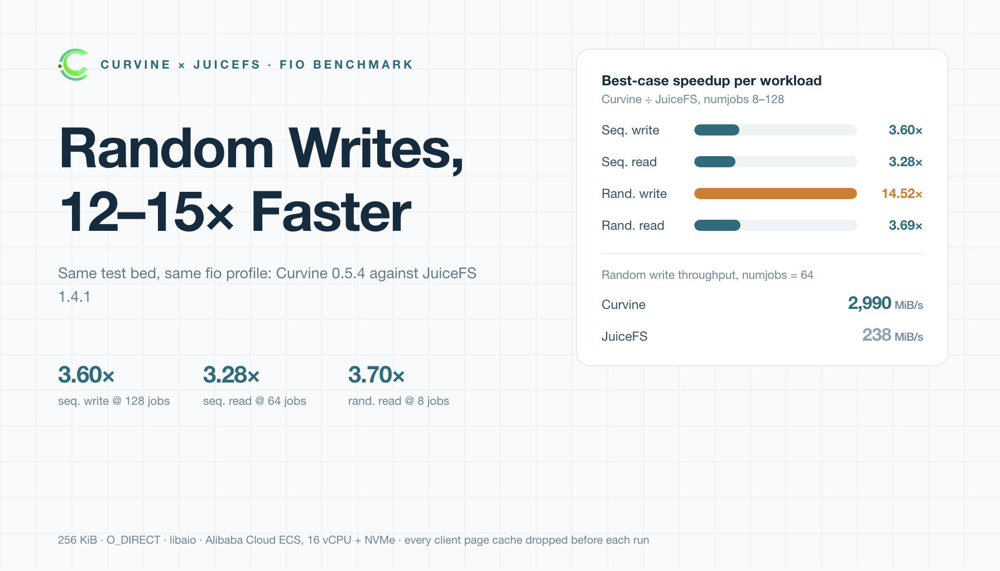
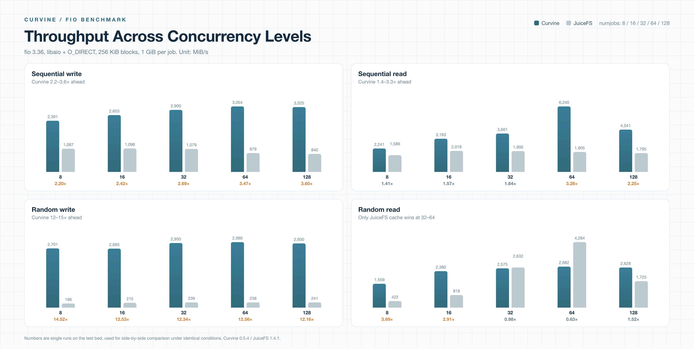
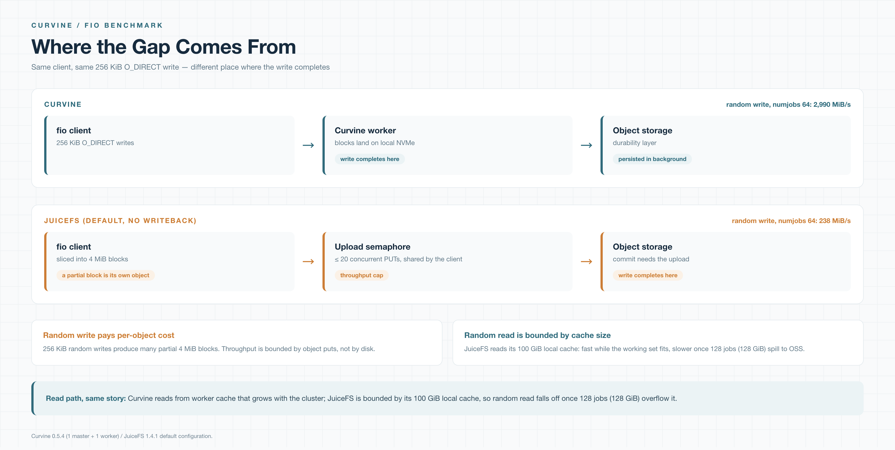

> Results first: on one test bed with an identical fio profile (256 KiB, `libaio` + `O_DIRECT`, 8–128 concurrent jobs), Curvine 0.5.4 beats JuiceFS 1.4.1 on **18 of 20 data points**. The gap is largest on **random write: 12–15×** (2,990 vs 238 MiB/s at 64 jobs). Sequential write peaks at **3.6×**, sequential read at **3.3×**. The two points JuiceFS wins are random read at 32 and 64 jobs, where its 100 GiB local cache serves the whole working set.

<!-- truncate -->

Both systems put a POSIX file system on top of object storage, and both are used as cache layers in front of data lakes and AI pipelines. The difference is where a write is considered complete. This post walks through the numbers, the setup, and what the write and read paths do differently.

## 1. What we ran

| Item | Configuration |
| --- | --- |
| Node | Alibaba Cloud ECS, 16 vCPU, 123 GiB RAM, kernel 6.8.0-88, 3.5 TiB NVMe data disk |
| Curvine | Open-source 0.5.4; 1 master + 1 worker + 1 client on machines of the spec above; data served from the worker's NVMe |
| JuiceFS | Open-source 1.4.1; metadata on a single Redis; data on an Alibaba Cloud OSS bucket (intranet endpoint), 4 MiB object blocks; client cache 100 GiB (`--cache-size=102400`) |
| Cache handling | `sync; echo 3 > /proc/sys/vm/drop_caches` before each group of runs, on the client only; worker and OSS-side caches are left alone |
| Load generator | fio 3.36, `libaio` + `O_DIRECT`, 256 KiB blocks, 1 GiB per job |

Metadata caching is left at defaults on both sides. Read tests reuse the files written by the write test at the same concurrency.

```bash
# sequential write
fio --name=seq_write --directory=<mount>/fio-test \
    --ioengine=libaio --direct=1 --bs=256k --size=1g --rw=write \
    --group_reporting --numjobs=<8|16|32|64|128> --end_fsync=1

# random write
fio --name=rand_write --directory=<mount>/fio-test \
    --ioengine=libaio --direct=1 --bs=256k --size=1g --rw=randwrite \
    --group_reporting --numjobs=<8|16|32|64|128> --end_fsync=1
```

Read tests run the same commands with `--rw=read` / `--rw=randread` and `--allow_file_create=0`. `end_fsync=1` is deliberate: each run only counts once the data is durable.

## 2. Throughput results

All values are MiB/s. The multiplier is Curvine ÷ JuiceFS; above 1 means Curvine is faster.



*Figure 1: Sequential and random throughput at 8, 16, 32, 64 and 128 jobs. Unit: MiB/s.*

### 2.1 Sequential write: 2.2–3.6×

| numjobs | Curvine | JuiceFS | Curvine ÷ JuiceFS |
| ---: | ---: | ---: | ---: |
| 8 | 2,391 | 1,087 | 2.20× |
| 16 | 2,653 | 1,096 | 2.42× |
| 32 | 2,900 | 1,079 | 2.69× |
| 64 | 3,054 | 879 | 3.47× |
| 128 | 3,025 | 840 | 3.60× |

Curvine scales with concurrency and flattens around 3 GiB/s from 64 jobs upward. JuiceFS holds near 1.1 GiB/s up to 32 jobs, then drops to 840–880 MiB/s. The gap widens as concurrency grows.

### 2.2 Sequential read: 1.4–3.3×, peak 6,240 MiB/s

| numjobs | Curvine | JuiceFS | Curvine ÷ JuiceFS |
| ---: | ---: | ---: | ---: |
| 8 | 2,241 | 1,586 | 1.41× |
| 16 | 3,163 | 2,018 | 1.57× |
| 32 | 3,661 | 1,995 | 1.84× |
| 64 | 6,240 | 1,905 | 3.28× |
| 128 | 4,041 | 1,795 | 2.25× |

JuiceFS reads from its 100 GiB local cache here, while Curvine reads from the worker's NVMe. Curvine still leads at every concurrency level, with a 6,240 MiB/s peak at 64 jobs.

### 2.3 Random write: 12–15×

| numjobs | Curvine | JuiceFS | Curvine ÷ JuiceFS |
| ---: | ---: | ---: | ---: |
| 8 | 2,701 | 186 | 14.52× |
| 16 | 2,693 | 215 | 12.53× |
| 32 | 2,950 | 239 | 12.34× |
| 64 | 2,990 | 238 | 12.56× |
| 128 | 2,930 | 241 | 12.16× |

This is the widest gap. Curvine's random write throughput (2.7–3.0 GiB/s) is essentially the same as its sequential write throughput, so a 256 KiB random write costs almost nothing extra. JuiceFS stays at 186–241 MiB/s — less than a quarter of its own sequential write.

### 2.4 Random read: cache capacity decides

| numjobs | Curvine | JuiceFS | Curvine ÷ JuiceFS |
| ---: | ---: | ---: | ---: |
| 8 | 1,559 | 422 | 3.70× |
| 16 | 2,380 | 818 | 2.91× |
| 32 | 2,575 | 2,632 | 0.98× |
| 64 | 2,682 | 4,284 | 0.63× |
| 128 | 2,628 | 1,725 | 1.52× |

Read this row by row:

- **8 and 16 jobs**: Curvine leads 3.70× and 2.91×.
- **32 jobs**: effectively a tie, with JuiceFS 2% ahead.
- **64 jobs**: JuiceFS reaches 4,284 MiB/s, 1.6× Curvine. The read working set is 64 GiB, which fits inside the 100 GiB local cache, so no request leaves the machine.
- **128 jobs**: the working set grows to 128 GiB and overflows the cache. JuiceFS falls to 1,725 MiB/s and Curvine leads again at 1.52×.

Curvine holds a flat 2.4–2.7 GiB/s across 16 to 128 jobs.

## 3. Where the gap comes from



*Figure 2: The write path decides when a 256 KiB write is considered complete.*

### 3.1 Writes finish at the worker, not at the object store

In this deployment the Curvine client sends blocks to the worker, where they land on local NVMe; object storage is the durability layer behind it. A write is complete once the worker has the data.

JuiceFS, in its default configuration (`--writeback` off), slices files into 4 MiB blocks and PUTs them to OSS. The upload semaphore is global to the client and defaults to 20 concurrent PUTs (`--max-uploads`), and `end_fsync=1` means each run waits for those uploads to finish and the metadata to commit.

That difference matters most for random writes. A 256 KiB random write in the middle of a file produces a partial block, and a partial block is still its own object with its own PUT. Throughput ends up bounded by object operations rather than by the disk. In the sequential case the writes coalesce into full 4 MiB blocks, which is why JuiceFS drops from ~1.1 GiB/s sequential to ~240 MiB/s random — and why Curvine, which keeps writing at NVMe speed, shows almost no difference between the two.

### 3.2 Reads are bounded by cache capacity

Random read is the reverse story. JuiceFS reads from a local 100 GiB cache, and that cache is hard to beat while it holds the whole working set: 32 GiB and 64 GiB fit, so throughput climbs to 4,284 MiB/s. At 128 GiB it no longer fits, misses go to OSS, and throughput halves.

Curvine's read cache lives in the worker tier instead, so its capacity grows with the cluster rather than with the client's disk. In this test the client reads over the network from a single worker, and the curve stays flat at 2.4–2.7 GiB/s from 16 to 128 jobs.

### 3.3 Predictability at high concurrency

Across sequential write, random write and random read, Curvine's line from 32 to 128 jobs is almost horizontal. JuiceFS drops at 64 jobs on sequential write and at 128 jobs on random read. For a training job or an agent platform where hundreds of processes hit storage at once, holding throughput as concurrency rises matters more than a single peak.

## 4. What it means for AI workloads

- **Checkpoint writes**: a checkpoint is a burst of large sequential writes, and the 2.2–3.6× sequential write lead translates directly into less time with GPUs idle.
- **Data preprocessing and shuffling**: these are random-heavy and metadata-heavy. A 12–15× random write advantage changes how long a preprocessing stage takes.
- **Agent workspaces**: many small files, constantly rewritten. The fact that random writes cost the same as sequential writes on Curvine is the relevant property.
- **Read-heavy analytics**: when the working set fits in a local cache, JuiceFS is competitive, and on a single client it can even win on random read. The advantage of Curvine is that the cache sits in the cluster and can be grown by adding workers, instead of being capped by one machine's disk.

## 5. Notes on the measurement

We would rather state the limits of this test than overstate the result:

1. These are **single runs** on one test bed, used for side-by-side comparison under identical conditions — not a performance ceiling for either system.
2. The two sides use their **default deployment shapes**: Curvine keeps data on worker NVMe, JuiceFS persists to OSS with a local read cache. That difference is real and is exactly what the test measures, but it also means this is not a comparison of a network-separated Curvine client.
3. Curvine runs as a **1 master + 1 worker** cluster, the smallest possible. Aggregated throughput grows with workers; adding nodes was not tested here.
4. **JuiceFS writeback mode was not tested.** Enabling `--writeback` moves uploads off the write path and would narrow the write gap substantially; the random-write gap should shrink but is unlikely to disappear while objects are still 4 MiB.
5. Both sides keep **default metadata caching**, and both were measured with the same fio binary and the same client-side cache flushing.

## 6. Summary

| Workload | Result |
| --- | --- |
| Sequential write | Curvine 2.2–3.6× ahead (128 jobs: 3,025 vs 840 MiB/s) |
| Sequential read | Curvine 1.4–3.3× ahead (64 jobs peak: 6,240 vs 1,905 MiB/s) |
| Random write | Curvine 12–15× ahead (2,701–2,990 vs 186–241 MiB/s) |
| Random read | Curvine 3.7×/2.9× ahead at 8/16 jobs; tie at 32; JuiceFS cache wins at 64; Curvine 1.5× ahead at 128 |

Out of 20 data points, Curvine is ahead on 18 and behind on 2. The workloads that benefit most are write-heavy and high-concurrency ones: checkpointing, data preprocessing, and agent workspaces.

Curvine is Apache-2.0 and available at [github.com/CurvineIO/curvine](https://github.com/CurvineIO/curvine). The full documentation, including deployment and other benchmarks, is at [curvineio.github.io](https://curvineio.github.io/docs/Overview/instroduction).

*Test environment: Curvine 0.5.4 / JuiceFS 1.4.1, Alibaba Cloud ECS 16 vCPU + 3.5 TiB NVMe. Results are environment-specific; reproduce with the commands above before sizing a cluster.*
