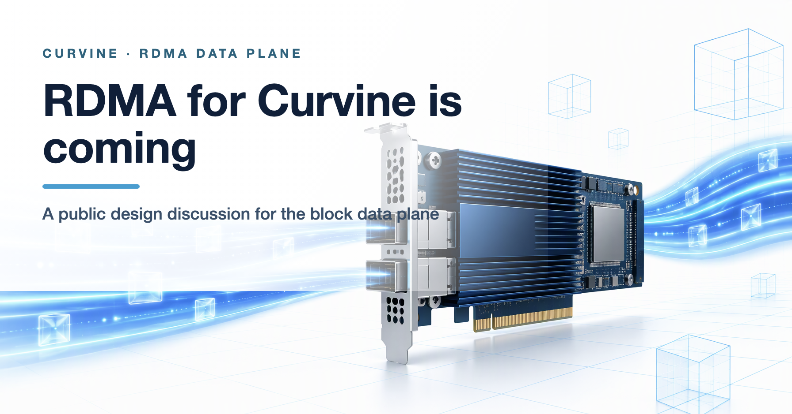

> Proposal first: keep Curvine's metadata and control RPCs on TCP, move block data to one-sided RDMA, and put every RDMA library behind one pluggable backend interface. libfabric is the primary backend, UCX is optional for GPU/HPC scenarios, raw verbs remains as the performance baseline and private-deployment fallback, and every path can fall back to TCP. This is a public design draft — critique and co-builders are welcome.

<!-- truncate -->

## 1. When GPUs wait on data, data waits on the protocol stack

The world storage systems face has changed over the past two years.

Large-model training feeds checkpoints to the cluster. Inference fleets pull vector indexes. Big-data jobs shuffle enormous intermediate results. The LanceDB and Milvus deployments behind AI applications scan tens of gigabytes of vector files over and over. These workloads share one property: **they are bandwidth-hungry, latency-sensitive, and increasingly ruthless**.

Curvine is a distributed cache filesystem built for AI and big-data workloads, and it has kept squeezing the data path:

- **Home-grown ORPC**: a 22-byte fixed protocol header plus a protobuf business header plus a raw data segment, with req_id multiplexing so many streams share one connection;
- **Zero copy**: on Linux, sendfile and splice hand the file-to-socket copy to the kernel, so a Worker reading from disk can write straight to the NIC;
- **SPDK block devices**: bypass the kernel block layer and reach NVMe-oF drives directly;
- **Three-phase block streams**: Open → Running → Complete turns large block I/O into a pipeline that can be retried.

But as single-node bandwidth climbed to 100G, 200G, even 400G, a new bottleneck surfaced: **the TCP/IP stack itself**.

Every block transfer pays syscalls, user/kernel transitions, socket buffer copies, and softirq processing. CPU time goes to the protocol stack, memory bandwidth goes to copies, and the actual business — disk and NIC — sits waiting.

In one sentence: Curvine is not slow; the block-data highway is missing its last express lane.

That lane is called RDMA.

## 2. The three worlds of RDMA

RDMA is not a single library; it is a family of capabilities. Over the past few years, only three API families have seen broad industry use as general-purpose user-space RDMA communication libraries.

| Option | In one line | Strengths | Cost |
| --- | --- | --- | --- |
| libibverbs + rdma_cm | The lowest-level native API | Zero abstraction overhead, the most complete feature set, the lowest latency ceiling | Connection management, QP state machines, and GID selection are all yours to write; the largest engineering effort |
| libfabric (OFI) | A unified fabric abstraction layer | One API covering verbs, rxm, EFA, PSM, CXI, and TCP through providers | Many concepts and a steep learning curve |
| UCX | A transport × protocol framework | The performance ceiling (the base of NCCL/MPI), GPUDirect, automatic multi-NIC selection | Heavy dependencies and configuration; overkill for pure storage workloads |

Beyond these, a few things look like options but are not quite: socket compatibility layers such as rsocket (fast to integrate, but limited in performance and semantics), high-level communication frameworks such as MPI, Mercury, and Margo (collective programming models that do not fit client-server storage), and specialized wire protocols such as NVMe-oF/RDMA, NFS-RDMA, and SMB Direct (Curvine's SPDK backend already uses NVMe-oF, but it cannot replace the filesystem data plane).

In short: **general-purpose libraries amount to three families plus three classes of wrappers and specialized protocols; only the first two-and-a-half are credible long-term backends for Curvine.**

## 3. Why libfabric

In the public discussion, our selection conclusion is:

> **libfabric as the primary backend, UCX as an optional backend for GPU/HPC, and raw verbs as the performance baseline and private-deployment fallback. The control plane stays on TCP.**

There are four reasons for libfabric.

**First, the provider model solves "multi-library adaptation" by construction.** libfabric does not implement RDMA itself. It defines a unified `fi_*` interface, and each provider implements it: the verbs provider for Mellanox-class hardware, the EFA provider on AWS, Intel's PSM provider, HPE Cray's CXI provider, even pure-software tcp and shm providers. Adapting libfabric once gets you most vendor NICs instead of maintaining one code path per vendor.

**Second, the programming model fits ORPC hand in glove.** libfabric's tagged messaging matches messages with a 64-bit tag, which maps directly to ORPC's req_id; `fi_write` and `fi_read` provide the one-sided RMA primitives that zero-copy block data needs.

**Third, the storage industry has already validated it.** DAOS's CaRT communication layer and large-scale storage traffic on AWS EFA both run on libfabric. This is not a lab-only technology.

**Fourth, the FFI maintenance cost is the lowest.** We only need to maintain one `libfabric-sys` binding; switching to UCX would multiply the API surface and configuration matrix, and the long-term maintenance cost with it.

When should you flip this choice? If you run a pure NVIDIA RoCE cluster and need direct GPU memory access (GPUDirect), UCX is the better answer; if you run a single-vendor private deployment that demands microsecond small messages, raw verbs fits better.

**And that is exactly why we are building a framework: to make this choice a configuration item, not a rewrite.**

## 4. The architecture proposal

### 4.1 One principle: split the planes, deliver incrementally

We are not going to tear down the whole RPC stack. The first version is a "split plane" design:

- **The control plane stays on TCP**: metadata RPCs are small and scattered; TCP's tens-of-microseconds latency is not the bottleneck, while changing it is expensive.
- **The data plane moves to RDMA separately**: block reads and writes are "large, sequential, client-driven" traffic, exactly the optimal shape for one-sided RDMA.

There is a hidden bonus: the existing `DataSlice::MemSlice` type and the BlockIO abstraction already exist, so data that RDMA lands in registered memory can be fed to the storage layer as-is — exactly how the SPDK backend is integrated today.

The architecture has four layers:

```
Application   FsWriter / FsReader / BlockClient / Replication
     |
Data plane    RdmaDataChannel (rendezvous)
     |
Abstraction   backend registry / capability negotiation / MR pool / CQ pump
     |
Backends      libfabric | UCX | verbs | TCP passthrough
```

The abstraction layer is an independent crate that always compiles — on a macOS dev machine it contains only the TCP passthrough backend; RDMA backends are enabled per feature, fail at compile time when their dependencies are missing, and leave default builds untouched.

### 4.2 Abstract operations, not registers

Abstracting verbs' post_send and poll_cq directly is a trap — that is verbs dialect, and libfabric and UCX do not share those semantics. What we abstract is **operation semantics plus capability declarations**:

```rust
pub struct Capabilities {
    pub one_sided_write: bool,
    pub one_sided_read: bool,
    pub tagged_msg: bool,
    pub max_msg_size: usize,
    // ...
}

pub trait RdmaConn: Send {
    /// Opaque handshake bytes: verbs carries QPN/GID,
    /// libfabric carries its connect blob, UCX carries the worker address.
    fn local_handshake(&self) -> Vec<u8>;
    fn establish(&mut self, peer: &[u8]) -> Result<()>;

    fn send(&self, ...) -> Result<()>;
    fn recv(&self, ...) -> Result<()>;
    fn write_remote(&self, ..., token: RemoteToken) -> Result<()>;
    fn read_remote(&self, ..., token: RemoteToken) -> Result<()>;
}
```

Three key decisions:

- **Opaque handshake**: the abstraction layer does not care about connection semantics; it only moves a blob of bytes. Connection setup reuses the existing ORPC channel for bootstrap, exchanging backend, capabilities, the handshake blob, and a session nonce.
- **Capability negotiation**: a backend without one-sided support automatically degrades to two-sided emulation; upper layers notice nothing.
- **Pluggability**: compile-time features first, then dlopen-loaded C-ABI plugins so vendor SDKs (domestic NICs, smart NICs) can integrate without code changes.

### 4.3 How a block travels

On the write path, the client issues WRITEs:

```
BlockClient                     Worker
  |-- OpenBlock (TCP control) ---->|
  |<-- AllocToken(rkey, addr) -----|  carve a landing buffer from the MR pool
  |== RDMA WRITE_WITH_IMM ========>|  zero-copy into MR, completion queues persistence
  |-- Complete (TCP control) ------>|
```

On the read path, the Worker writes into a client-registered receive buffer:

```
Client: ReadBlock{ recv_token, credits }  --->  Worker
Worker: disk read -> registered MR -> RDMA WRITE -> Client MR -> FUSE
```

Throughput and flow control use credits plus an inflight cap; the receiver can brake at any time.

One honest boundary: **the disk-to-memory copy cannot be eliminated** (unless going through NVMe-oF or GPU peer-to-peer). What RDMA eliminates is the protocol stack, syscalls, and socket buffer copies — one copy on the client side and one on the Worker side. For block I/O, that is already the largest slice of the cake.

### 4.4 The details that decide success

A few engineering details make or break the design:

- **Memory registration pool**: MRs are pinned physical pages, so the whole pool must be registered with hugepages at startup and carved by offset. Never call reg_mr per operation on the data path.
- **CQ-to-tokio bridge**: one shared completion queue per IO thread, busy-polled when busy and parked on an eventfd when idle; completions wake async tasks through oneshot channels, coalescing batched wakes.
- **Backpressure**: inflight is capped by the number of pool buffers; an empty pool means awaiting, which is natural flow control.
- **Degradation and circuit breaking**: a capability mismatch falls back to TCP directly; QP errors fail fast, reconnect with exponential backoff, and a circuit breaker falls back to TCP after repeated failures. RDMA is never a single point of availability.
- **Security**: an rkey is effectively a credential to write remote memory. Tokens are bound to a session nonce, invalidated after a single transfer, MRs carry minimal permissions, and only management-network connections are accepted. None of this is optional.
- **Observability**: byte counters, inflight, CQ depth, and completion-latency histograms all flow into MetricsReport; a CLI `rdma probe` performs preflight checks.

### 4.5 Roadmap

| Phase | Content |
| --- | --- |
| M0 | Abstraction layer + TCP passthrough + conformance tests, zero behavior change |
| M1 | libfabric backend handshake and small messages pass over soft-RoCE |
| M2 | Data-plane rendezvous: write path, read path, MR pool, degradation and circuit breaking |
| M3 | UCX backend, multi-rail/NUMA, metrics and the preflight tool |
| M4 | verbs baseline backend, dlopen plugins, vendor SDK integration |

Every phase can merge independently, and every step can fall back to TCP. Engineering quality before novelty.

## 5. Why this must be built together

Frankly, RDMA adaptation is not something Curvine can finish alone, for two reasons.

**Hardware is fragmented.** Mellanox, Broadcom, Intel, AWS EFA, HPE Cray, domestic NICs, and a zoo of smart NICs and DPUs — each has its own temperament. libfabric's provider model covers most of them, but real compatibility, performance tuning, and failure modes are best understood by the people holding the hardware.

**Scenarios are fragmented.** AI training wants throughput and GPU direct access; inference caching wants low latency and high concurrency; vector search wants large sequential reads; big data wants multi-tenant isolation and stability. Every data path has a different sweet spot.

So we are making the design public: two full design discussions, in Chinese and English, are live in Curvine's GitHub Discussions, covering selection analysis, a trait draft, data-flow sequences, the configuration shape, a risk list, and open questions.

**We are looking for these partners:**

- **NIC and DPU vendors**: turn your device into an RDMA backend plugin so every Curvine user gets it out of the box;
- **Cloud vendors and infrastructure teams**: real-workload validation on EFA, PSM, CXI, and other cloud RDMA environments;
- **AI infrastructure and vector database teams**: bring your IO patterns and help define the data-plane semantics;
- **Storage and filesystem developers**: MR pools, CQ scheduling, multi-rail path selection — hard problems, and hard critiques, are welcome;
- **Teams with test environments**: one RoCE switch or one EFA cluster is the best gift for M1.

**How to join:**

- Chinese design discussion: https://github.com/CurvineIO/curvine/discussions/2296
- English discussion: https://github.com/CurvineIO/curvine/discussions/2299
- Code repository: https://github.com/CurvineIO/curvine

Curvine is open source under Apache 2.0. Designs discussed in public, code reviewed in public, benefits shared — this is not a slogan; it is how we build this project.

## 6. Closing

RDMA for Curvine is coming.

But the subject of "coming" was never one person or one company.

It is everyone who has been slowed down by a protocol stack, everyone who has tuned PFC in a machine room, everyone who wants storage to keep up with compute.

The road is drawn. The first brick is waiting for you.

*This post is based on Curvine's public design discussions. Leave your judgment, doubts, and proposals in GitHub Discussions — a design that gets criticized hard is a design that ships stable.*
