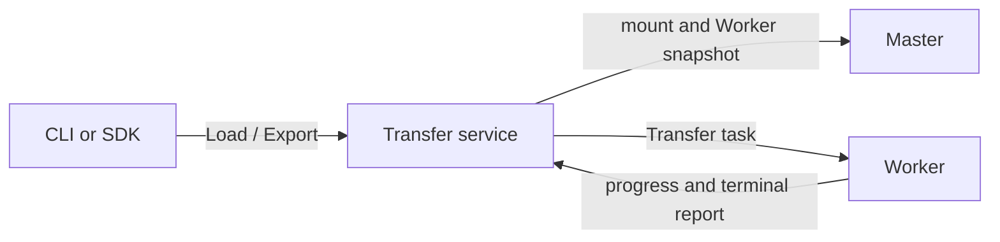

# Transfer Service

Transfer runs every Load and Export job. It keeps job state, plans work from
mount and Worker information, dispatches tasks to Workers, and receives task
reports. It does not host a replica of the full Curvine metadata tree.



## Embedded and Standalone Modes

The `[transfer]` section chooses where the service runs:

| Mode | Selected by | Where it runs | Job store |
| --- | --- | --- | --- |
| Embedded (default) | No `endpoints` | Inside the leader Master, on the Master's RPC port; it logs to the Master log | The Master's memory |
| Standalone | `endpoints` set (optionally with `mode = "standalone"`) | One or more separate `curvine-transfer` processes | SQLite for one instance, or a shared MySQL or PostgreSQL database |

A cluster needs no Transfer deployment and no `[transfer]` settings: with the
default configuration, `cv load`, `cv export`, and `cv transfer` reach the
embedded service through the `[client]` Master addresses. Deploy a standalone
service when job state must be kept in a database, or when transfer planning
should run outside the Master.

## Configuration for a Standalone Service

| Component | Required change | Notes |
| --- | --- | --- |
| Transfer service | `endpoints`, a persistent `store_url`, and the cluster's `[client]` Master addresses. | `endpoints` is the address clients use; it can differ from `hostname`, for example behind a load balancer. |
| Master | The same `endpoints`. | The Master then runs no embedded transfer, and its own submissions (such as fs-mode write-back) go to the service. Without them it keeps running the embedded service. |
| CLI, SDK, and FUSE clients | The same `endpoints`. | A client without them sends its requests to the Master, which rejects them once it is configured for a standalone service ("transfer RPC is not served by this master"). |
| Worker | None. | Report endpoints are included in each task. |

Clients never need a database URL. The store belongs only to the Transfer
service.

## Choose a State Store

| Store | Topology | Use it when |
| --- | --- | --- |
| SQLite | One Transfer instance and one persistent local volume. | Evaluation, development, or a single-instance deployment. |
| MySQL | Two or more Transfer instances sharing one database. | Production high availability and rolling service upgrades. |

Never point multiple Transfer instances at independent SQLite files. They would
hold different job state and cannot fail over correctly.

The embedded service always uses the in-memory store and rejects any other
`store_url` at startup, so a configuration without `endpoints` must not set
`store_url`.

## Required Configuration

The Transfer server needs a complete cluster configuration, including
`[client]` Master addresses, and this section:

```toml
[transfer]
store_url = "sqlite:///var/lib/curvine-transfer/transfer.db"
hostname = "transfer-1.example.com"
endpoints = ["transfer-1.example.com:9010"]
```

For a MySQL-backed service, replace `store_url` with a shared MySQL URL. Do not
put credentials in a client configuration file or a ConfigMap.

The Master and the clients need only the address:

```toml
[transfer]
endpoints = ["transfer-1.example.com:9010"]
```

Curvine no longer derives an endpoint from `hostname:rpc_port`: without
`endpoints` a process uses embedded mode, and `mode = "standalone"` without
`endpoints` fails validation.

## Deploy and Verify

- [Deploy on bare metal](./1-Bare-Metal.md)
- [Deploy on Kubernetes](./2-Kubernetes.md)
- [Transfer configuration reference](../2-Deploy-Curvine-Cluster/3-Distributed-Mode/03-conf.md#transfer)

After deployment, run `cv transfer list` from a client with the same
`endpoints`. Submit a small mounted UFS file with `cv load <path> --watch`,
then verify that the job reaches `Completed` and the target can be read with
`cv fs --cache-only get`.

## Switching Modes

To move a cluster between embedded and standalone mode, change `[transfer]` in
the Master, Transfer, and client configurations together and restart those
processes. Job records are not copied between the in-memory store and a
standalone store, so wait for running jobs to finish first
(`cv transfer list --state running`). Do not delete a Transfer store while jobs
are active.
