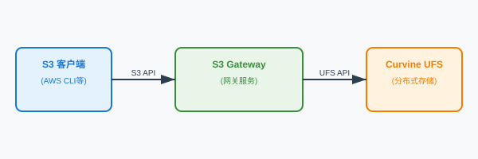

# S3 Object Storage Gateway

The Curvine S3 gateway exposes a Curvine cluster through an S3-compatible HTTP API. Tools that already speak S3 — the AWS CLI, MinIO Client, boto3, or any S3 SDK — can read and write Curvine paths without FUSE or a native Curvine client. The gateway authenticates each request with AWS Signature V2/V4 and translates bucket and key names into Curvine filesystem operations.

:::info
The gateway is an optional, standalone service. It is not started by `curvine-server` and is not included in the default release package yet. Build it explicitly with `cargo build --release --bin curvine-s3-gateway` and run it alongside a Curvine cluster.
:::

## Overview

S3 requests enter the gateway, are authenticated against a credential store, and are executed through the Curvine client. Object data streams through the gateway to and from Curvine Workers, so an entire object is never buffered in memory.

### Key Features

- S3-compatible bucket and object APIs (see [Supported S3 Operations](#supported-s3-operations))
- AWS Signature V2/V4 authentication with a local or Curvine-hosted credential store
- HTTP Range requests with `206 Partial Content` responses
- Multipart upload for large objects
- Streaming reads and writes
- Standalone deployment that can be scaled behind a load balancer

### Architecture Overview

The S3 gateway is the frontend for S3 API clients; it converts S3 requests into Curvine filesystem operations:



## Supported S3 Operations

### Bucket operations

| Operation | HTTP request |
| --- | --- |
| `CreateBucket` | `PUT /{bucket}` |
| `HeadBucket` | `HEAD /{bucket}` |
| `DeleteBucket` | `DELETE /{bucket}` |
| `ListBuckets` | `GET /` |
| `GetBucketLocation` | `GET /{bucket}?location` |

### Object operations

| Operation | HTTP request |
| --- | --- |
| `PutObject` | `PUT /{bucket}/{key}` |
| `GetObject` | `GET /{bucket}/{key}` |
| `HeadObject` | `HEAD /{bucket}/{key}` |
| `DeleteObject` | `DELETE /{bucket}/{key}` |
| `ListObjectsV2` | `GET /{bucket}?list-type=2` |
| `DeleteObjects` (batch) | `POST /{bucket}?delete` |

### Multipart upload

| Operation | HTTP request |
| --- | --- |
| `CreateMultipartUpload` | `POST /{bucket}/{key}?uploads` |
| `UploadPart` | `PUT /{bucket}/{key}?partNumber={n}&uploadId={id}` |
| `CompleteMultipartUpload` | `POST /{bucket}/{key}?uploadId={id}` |

:::note
`CopyObject` and `AbortMultipartUpload` are not implemented, and `ListObjectsV2` does not paginate. See [Limitations](#limitations).
:::

## Path Mapping

The gateway maps S3 paths onto the Curvine namespace without an extra prefix:

| S3 path | Curvine path |
| --- | --- |
| Bucket `my-bucket` | `/my-bucket` |
| Object `my-bucket/folder/file.txt` | `/my-bucket/folder/file.txt` |

Buckets are regular Curvine directories, and objects are regular files. A bucket must exist before objects can be written to it, and it can also be browsed through FUSE, the CLI, or the SDK.

## Getting Started

### 1. Build the gateway

```bash
cargo build --release --bin curvine-s3-gateway
```

The binary is written to `target/release/curvine-s3-gateway`. Release packages do not ship it yet, so run it from the build output or copy it to the machine that will host the gateway.

### 2. Configure the cluster connection

The gateway reuses the regular Curvine cluster configuration file. Add an `[s3_gateway]` section for gateway-specific settings; the `[client]`, `[master]`, and other sections are used to connect to the cluster:

```toml
[s3_gateway]
listen = "0.0.0.0:9900"
region = "us-east-1"
put_temp_dir = "/tmp/curvine-temp"
```

See [Configuration](#configuration) for every option.

### 3. Create credentials

The gateway has no built-in default credentials. Generate a key pair and store it in the credential store:

```bash
target/release/curvine-s3-gateway credential generate --description "local test"
```

Or register an existing pair (the access key must be 16–32 characters and the secret key 16–64 characters):

```bash
target/release/curvine-s3-gateway credential add \
    --access-key "$ACCESS_KEY" \
    --secret-key "$SECRET_KEY" \
    --description "application A"
```

Both commands use the credential store selected by the configuration file. See [Credential Management](#credential-management).

### 4. Start the gateway

```bash
target/release/curvine-s3-gateway --conf etc/curvine-cluster.toml
```

The default listen address is `0.0.0.0:9900`. Override it and the region on the command line:

```bash
target/release/curvine-s3-gateway \
    --conf etc/curvine-cluster.toml \
    --listen 0.0.0.0:9000 \
    --region us-west-2
```

:::note
`--listen` and `--region` override the configuration file only when they are set to a value other than their built-in defaults (`0.0.0.0:9900` and `us-east-1`). Use the configuration file for those two values, or pass a different value explicitly.
:::

### 5. Verify

```bash
curl http://localhost:9900/healthz
# ok
```

## Configuration

### Command-line arguments

| Argument | Description | Default |
| --- | --- | --- |
| `--conf` | Curvine cluster configuration file | `etc/curvine-cluster.toml` |
| `--listen` | Listen address (`host:port`) | `0.0.0.0:9900` |
| `--region` | S3 region identifier | `us-east-1` |
| `--credentials-path` | Override the credential store path | Value from `[s3_gateway]` |
| `serve` | Optional subcommand; starting without a subcommand serves requests | — |
| `credential add\|generate\|list\|stats` | Credential management subcommands | — |

### `[s3_gateway]` configuration

| Parameter | Type | Default | Description |
| --- | --- | --- | --- |
| `listen` | string | `"0.0.0.0:9900"` | Listen address and port |
| `region` | string | `"us-east-1"` | S3 region identifier |
| `put_temp_dir` | string | `"/tmp/curvine-temp"` | Temporary directory for PUT operations (regular and multipart) in local storage mode |
| `put_memory_buffer_threshold` | integer | `1048576` | Objects smaller than this (bytes) are buffered in memory during PUT |
| `put_max_memory_buffer` | integer | `16777216` | Maximum in-memory buffer size for PUT (bytes) |
| `get_chunk_size_mb` | float | `1.0` | Read/write chunk size for GET responses, in MB |
| `enable_distributed_auth` | boolean | `false` | Store credentials in Curvine instead of the local filesystem |
| `credentials_path` | string | See below | Credential store path |
| `cache_refresh_interval_secs` | integer | `30` | Credential cache refresh interval, in seconds |

`worker.enable_s3_gateway` (in the `[worker]` section) selects distributed multipart storage: upload parts are written under `/.s3temp` in Curvine instead of `put_temp_dir`, so any gateway instance can complete an upload. Setting it also switches the binary to the distributed credential store.

**Credential store path:**

- Local mode (`enable_distributed_auth = false`): defaults to `~/.curvine/credentials.jsonl`
- Distributed mode (`enable_distributed_auth = true`): defaults to `/system/auth/credentials.jsonl`

**Example configuration:**

```toml
[s3_gateway]
# Listen address for the S3 API (host:port)
listen = "0.0.0.0:9900"

# S3 region returned to clients
region = "us-east-1"

# Temporary directory for PUT and multipart uploads (local storage mode)
put_temp_dir = "/tmp/curvine-temp"

# Objects smaller than this are buffered in memory during PUT (bytes)
put_memory_buffer_threshold = 1048576

# Maximum in-memory buffer for PUT (bytes)
put_max_memory_buffer = 16777216

# GET read/write chunk size (MB)
get_chunk_size_mb = 1.0

# Local credential store (default)
enable_distributed_auth = false
credentials_path = "~/.curvine/credentials.jsonl"

# Distributed credential store
# enable_distributed_auth = true
# credentials_path = "/system/auth/credentials.jsonl"

# Credential cache refresh interval (seconds)
cache_refresh_interval_secs = 30
```

## Credential Management

Credentials are stored in JSONL format, one entry per line:

```json
{"access_key":"AKIA...","secret_key":"...","created_at":1735689600,"enabled":true,"description":"application A"}
```

### Environment variables

| Variable | Description |
| --- | --- |
| `AWS_ACCESS_KEY_ID` or `CURVINE_ACCESS_KEY` | Access key |
| `AWS_SECRET_ACCESS_KEY` or `CURVINE_SECRET_KEY` | Secret key |
| `RUST_LOG` | Log level (for example `info`, `debug`, `curvine_s3_gateway::auth=debug`) |

The gateway imports environment credentials only when the configured credential store is empty; the imported pair is written to the local credential store. If neither a stored credential nor an environment pair is available, the gateway starts with an empty store and rejects every request.

### Commands

```bash
# Generate a random key pair and print it
target/release/curvine-s3-gateway credential generate --description "test key"

# Register an existing key pair
target/release/curvine-s3-gateway credential add \
    --access-key "$ACCESS_KEY" \
    --secret-key "$SECRET_KEY" \
    --description "application A"

# List credentials (secrets hidden)
target/release/curvine-s3-gateway credential list

# List credentials including secrets
target/release/curvine-s3-gateway credential list --show-secrets

# Show credential cache statistics
target/release/curvine-s3-gateway credential stats
```

:::warning
`credential list --show-secrets` and `credential generate` print secret keys to the terminal. Treat that output as sensitive and avoid shell history or shared logs.
:::

## Usage Examples

The examples below use `AWS_ACCESS_KEY_ID` and `AWS_SECRET_ACCESS_KEY`. Export the pair you created in [Getting Started](#getting-started) first:

```bash
export AWS_ACCESS_KEY_ID="$ACCESS_KEY"
export AWS_SECRET_ACCESS_KEY="$SECRET_KEY"
export AWS_DEFAULT_REGION=us-east-1
```

### AWS CLI

```bash
# Create a bucket
aws s3 mb s3://my-bucket --endpoint-url http://localhost:9900

# Upload a file
aws s3 cp /path/to/local/file.txt s3://my-bucket/ --endpoint-url http://localhost:9900

# Download a file
aws s3 cp s3://my-bucket/file.txt /tmp/ --endpoint-url http://localhost:9900

# List objects
aws s3 ls s3://my-bucket/ --endpoint-url http://localhost:9900

# Delete an object
aws s3 rm s3://my-bucket/file.txt --endpoint-url http://localhost:9900

# Delete a bucket
aws s3 rb s3://my-bucket --endpoint-url http://localhost:9900

# Sync a directory
aws s3 sync /local/directory s3://my-bucket/prefix/ --endpoint-url http://localhost:9900
```

### MinIO Client (mc)

```bash
mc alias set curvine http://localhost:9900 "$AWS_ACCESS_KEY_ID" "$AWS_SECRET_ACCESS_KEY"

mc mb curvine/my-bucket
mc cp /path/to/file.txt curvine/my-bucket/
mc cp curvine/my-bucket/file.txt /tmp/
mc ls curvine/my-bucket/
mc mirror /local/directory curvine/my-bucket/prefix/
```

### Python boto3

```python
import os
import boto3

s3_client = boto3.client(
    's3',
    endpoint_url='http://localhost:9900',
    aws_access_key_id=os.environ['AWS_ACCESS_KEY_ID'],
    aws_secret_access_key=os.environ['AWS_SECRET_ACCESS_KEY'],
    region_name='us-east-1',
)

s3_client.create_bucket(Bucket='my-python-bucket')

with open('local-file.txt', 'rb') as f:
    s3_client.put_object(Bucket='my-python-bucket', Key='remote-file.txt', Body=f)

response = s3_client.get_object(Bucket='my-python-bucket', Key='remote-file.txt')
data = response['Body'].read()

response = s3_client.list_objects_v2(Bucket='my-python-bucket')
for obj in response.get('Contents', []):
    print(f"Object: {obj['Key']}, Size: {obj['Size']}")
```

### Range requests

```bash
# First 1000 bytes
curl -H "Range: bytes=0-999" \
     -H "Authorization: AWS4-HMAC-SHA256 ..." \
     http://localhost:9900/my-bucket/file.txt

# Last 1000 bytes
curl -H "Range: bytes=-1000" \
     -H "Authorization: AWS4-HMAC-SHA256 ..." \
     http://localhost:9900/my-bucket/file.txt
```

Range responses use status `206` and include a `Content-Range` header. Signed requests are easiest to produce through an S3 SDK or the AWS CLI.

### Multipart upload

```bash
# Initiate upload
aws s3api create-multipart-upload \
    --bucket my-bucket \
    --key large-file.zip \
    --endpoint-url http://localhost:9900

# Upload a part
aws s3api upload-part \
    --bucket my-bucket \
    --key large-file.zip \
    --part-number 1 \
    --upload-id "$UPLOAD_ID" \
    --body part1.bin \
    --endpoint-url http://localhost:9900

# Complete upload
aws s3api complete-multipart-upload \
    --bucket my-bucket \
    --key large-file.zip \
    --upload-id "$UPLOAD_ID" \
    --multipart-upload file://parts.json \
    --endpoint-url http://localhost:9900
```

:::note
`AbortMultipartUpload` is not routed yet, so an abandoned upload leaves its parts in the temporary storage directory. Remove them manually.
:::

## Deployment

### Single instance

Run the binary under your process manager (systemd, supervisor, Kubernetes). No start/stop script is shipped yet:

```ini
[Unit]
Description=Curvine S3 Gateway
After=network.target

[Service]
ExecStart=/opt/curvine/bin/curvine-s3-gateway --conf /opt/curvine/conf/curvine-cluster.toml
Restart=on-failure
Environment=RUST_LOG=info

[Install]
WantedBy=multi-user.target
```

### Multiple instances

The gateway is stateless apart from temporary multipart data and credentials, so it can run behind a load balancer:

```nginx
upstream s3_gateway {
    server 192.168.1.10:9900 weight=1;
    server 192.168.1.11:9900 weight=1;
    server 192.168.1.12:9900 weight=1;
}

server {
    listen 80;
    server_name s3-gateway.example.com;

    location / {
        proxy_pass http://s3_gateway;
        proxy_set_header Host $host;
        proxy_set_header X-Real-IP $remote_addr;
        proxy_set_header X-Forwarded-For $proxy_add_x_forwarded_for;

        proxy_buffering off;
        proxy_request_buffering off;
        client_max_body_size 0;
    }
}
```

For more than one gateway instance, enable distributed multipart storage and distributed credentials so that any instance can complete an upload:

```toml
[s3_gateway]
enable_distributed_auth = true

[worker]
enable_s3_gateway = true
```

Without distributed storage, upload parts stay in the local `put_temp_dir` of the instance that received them; a `CompleteMultipartUpload` routed to a different instance cannot find them. Alternatively, configure session affinity on the load balancer.

### Health check

```bash
curl http://localhost:9900/healthz
# ok
```

## Monitoring and Logging

The gateway logs through `tracing` to stdout. Adjust the level with `RUST_LOG`:

```bash
# General debugging
export RUST_LOG=curvine_s3_gateway=debug

# Authentication debugging
export RUST_LOG=curvine_s3_gateway::auth=debug

# Everything (very verbose)
export RUST_LOG=trace
```

Logs cover request handling, authentication failures, multipart operations, and filesystem errors. There is no metrics endpoint yet; use the `/healthz` endpoint for liveness checks.

## Limitations

- `CopyObject` is not implemented; clients must download and re-upload.
- `AbortMultipartUpload` is not implemented; abandoned uploads leave temporary parts behind.
- `ListObjectsV2` returns a single page: `continuation-token` and `max-keys` are ignored, and `is-truncated` is always `false`.
- Conditional request headers (`If-Match`, `If-None-Match`) are accepted but not evaluated.
- When Curvine trash is enabled, `DeleteObject` and `DeleteBucket` move data into the recycle bin instead of removing it permanently.

## Troubleshooting

### Port already in use

Change the listen address in `[s3_gateway]` or pass a different `--listen` value:

```bash
target/release/curvine-s3-gateway --conf etc/curvine-cluster.toml --listen 0.0.0.0:9901
```

### Authentication failures

```bash
# Check the environment
echo "$AWS_ACCESS_KEY_ID"
echo "$AWS_SECRET_ACCESS_KEY"

# Check the credential store
target/release/curvine-s3-gateway credential list
target/release/curvine-s3-gateway credential stats

# Enable authentication logs
export RUST_LOG=curvine_s3_gateway::auth=debug
```

### Configuration file errors

If the configuration file cannot be loaded, the gateway prints a warning and continues with defaults. Verify the path and TOML syntax:

```bash
target/release/curvine-s3-gateway --conf /path/to/curvine-cluster.toml
```

### Bucket not found

Create the bucket before uploading (`aws s3 mb`), because the gateway does not create buckets implicitly.

### Connectivity check

```bash
curl -v http://localhost:9900/healthz
netstat -tlnp | grep 9900
```

## Performance Tuning

```bash
# Increase the file descriptor limit
ulimit -n 65536

# TCP and socket buffer tuning
echo 'net.ipv4.tcp_keepalive_time = 600' >> /etc/sysctl.conf
echo 'net.core.rmem_max = 16777216' >> /etc/sysctl.conf
echo 'net.core.wmem_max = 16777216' >> /etc/sysctl.conf
sysctl -p
```

For large-object workloads, increase `get_chunk_size_mb` and make sure `put_temp_dir` is on fast local storage. When `worker.enable_s3_gateway = true`, multipart parts are written directly to Curvine and `put_temp_dir` is not used for them.
