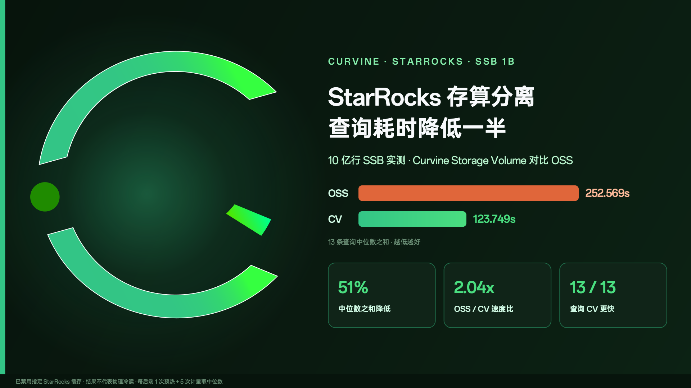
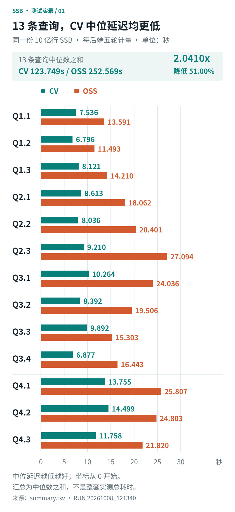
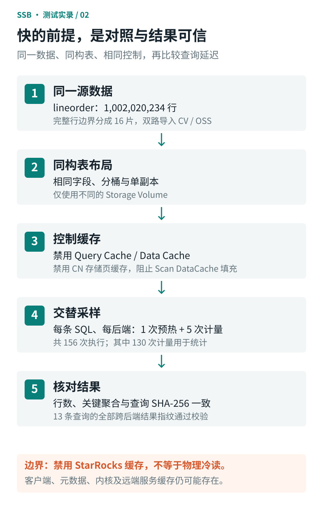

> StarRocks 存算分离集群，同一份 10 亿行 SSB 数据，分别放在 Curvine Storage Volume 和 OSS 上。关闭指定的 StarRocks 缓存后，13 条查询的中位延迟都是 Curvine 更低，13 个中位数相加从 252.569 秒降到 123.749 秒，降幅 51%。

<!-- truncate -->

存算分离架构下，数据放在对象存储里，计算节点可以按需扩缩，存储成本也更低。代价是每次扫描都要走远端读取，OSS/S3 的访问延迟和吞吐上限会直接反映到查询耗时上。

我们想知道，在 StarRocks 和对象存储之间加一层 Curvine，对分析查询能有多少改善。这次用 Star Schema Benchmark（SSB）做了一轮对比测试，下面是测试方法、结果和接入配置。

文中 CV 指 Curvine Storage Volume，OSS 指直接使用对象存储作为 Storage Volume。

## 一、测试结果

SSB 包含 13 条标准查询（Q1.1 ~ Q4.3），覆盖多维过滤、多表关联和聚合。每条查询在每个后端上跑 1 次预热、5 次计量，取 5 次计量的中位数。



图 1：每个后端 5 次计量的中位数，预热不计入，单位为秒，越低越好。

具体数据如下：

| 查询 | CV（秒） | OSS（秒） | 降幅 |
| --- | ---: | ---: | ---: |
| Q1.1 | 7.536 | 13.591 | 44.55% |
| Q1.2 | 6.796 | 11.493 | 40.87% |
| Q1.3 | 8.121 | 14.210 | 42.85% |
| Q2.1 | 8.613 | 18.062 | 52.31% |
| Q2.2 | 8.036 | 20.401 | 60.61% |
| Q2.3 | 9.210 | 27.094 | 66.01% |
| Q3.1 | 10.264 | 24.036 | 57.30% |
| Q3.2 | 8.392 | 19.506 | 56.98% |
| Q3.3 | 9.892 | 15.303 | 35.36% |
| Q3.4 | 6.877 | 16.443 | 58.18% |
| Q4.1 | 13.755 | 25.807 | 46.70% |
| Q4.2 | 14.499 | 24.803 | 41.54% |
| Q4.3 | 11.758 | 21.820 | 46.11% |
| 中位数之和 | 123.749 | 252.569 | 51.00% |

几个结论：

1. 13 条查询中，CV 的中位延迟全部低于 OSS。
2. 13 个中位数相加，OSS 为 252.569 秒，CV 为 123.749 秒，OSS / CV 为 2.04 倍。
3. 降幅最大的是 Q2.3，从 27.094 秒降到 9.210 秒，降低 66.01%。
4. 降幅最小的是 Q3.3，为 35.36%。

“中位数之和”是把 13 条查询各自的中位数加起来，用来做整体比较，不等于整套测试实际运行的总耗时。

## 二、测试怎么做的

存储对比测试容易受到数据差异、表结构差异和缓存的干扰。这次从数据、表布局、缓存、采样顺序和结果校验五个方面做了控制。



图 2：测试流程。156 次执行包含 26 次预热和 130 次计量，只有计量样本参与统计。

### 1. 数据规模与导入

SSB 核心事实表 `lineorder` 共 1,002,020,234 行，原始数据文件 105 GB，全库约 10.08 亿行。

数据按完整行边界切成 16 片，通过 Stream Load 分别导入 CV 和 OSS。两边导入行数一致，过滤行数都是 0。导入完成后对比了 `COUNT(*)`、`SUM(lo_orderkey)`、`SUM(lo_revenue)`、`SUM(lo_supplycost)`，两边结果一致。

这一步校验的是行数和关键聚合值，没有做逐行、逐字节比对。

### 2. 表布局

两边的表使用相同的字段、分桶和单副本设置，唯一的区别是 Storage Volume 不同。

### 3. 缓存控制

为了让查询尽量落到存储层，测试中关闭了以下 StarRocks 缓存：

- `enable_query_cache = false`：关闭 Query Cache
- `enable_scan_datacache = false`、`datacache.enable = false`：关闭扫描和表级 Data Cache
- `populate_datacache_mode = 'never'`：不填充 Data Cache
- `disable_storage_page_cache = true`：关闭 CN 节点的存储页缓存

需要说明的是，这些设置只覆盖 StarRocks 自身的缓存。客户端、元数据、JVM、操作系统内核以及远端服务端的缓存仍可能存在，所以本次结果不应理解为物理冷读性能。

### 4. 采样方式

每条查询在每个后端上执行 1 次预热、5 次计量，13 条查询共 156 次执行，其中 26 次预热、130 次计量。CV 和 OSS 交替运行，避免固定先后顺序带来的偏差。

### 5. 结果校验

156 次执行的查询结果都计算了 SHA-256 指纹。所有轮次、两个后端的指纹一致，说明两边返回的结果相同。

## 三、性能差异从哪里来

计算集群、表布局、SQL 和查询设置都相同，差异只来自存储层。结合 Curvine 的架构和查询 Profile，主要有以下几个原因。

### 1. 数据离计算更近

直接读 OSS 时，每次扫描都要发起远端 HTTP 请求，受网络带宽和连接建立开销的限制。

Curvine 采用 Master-Worker 架构，Worker 可以部署在 CN 节点本地或相邻节点上，使用内存、NVMe SSD、HDD 组成多级缓存。列存文件第一次加载后会留在本地介质中，之后的读取变成本地读或局域网读，延迟和吞吐都比访问远端对象存储稳定。

### 2. Rust + Tokio 的异步 I/O

Curvine 的核心用 Rust 编写，基于 Tokio 异步运行时。没有 GC 停顿，运行时开销小，配合零拷贝的数据传输，在高并发读取时 CPU 占用较低。像 Q2.3、Q4.1 这类多表关联查询会同时发起大量读请求，这部分开销的差异会体现在延迟上。

### 3. 面向扫描场景的读路径

Curvine 同时提供 POSIX FUSE 接口和客户端 SDK，读路径上做了预读（Read-ahead）和并发读句柄池（ReaderPool），避免多个线程并发读同一文件时互相排队。

从 Q4.1 的 Profile 看，CV 上列存段初始化（`SegmentInit` / `ColumnFileOpen`）更快，顺序读吞吐更高，大表扫描的 `IOTime` 明显低于 OSS。

### 4. 元数据访问

Curvine 的集群元数据通过 Raft 管理。大量列存文件并发扫描时，元数据缓存和并行定位减少了打开文件、查找元数据的耗时，降低了长尾请求的影响。

## 四、StarRocks 接入 Curvine 的配置

### 1. 接入方式

StarRocks 通过 Hadoop 兼容的 FileSystem 接口访问 Curvine。在 CN 节点上放入 Curvine Hadoop 客户端 JAR，并在 `core-site.xml` 中注册 `io.curvine.CurvineFileSystem` 和 `io.curvine.CurvineAbstractFileSystem`，StarRocks 就可以用 `cv://` 协议读写 Curvine。

元数据请求通过 RPC 发到 Master，数据读写走 Worker。

### 2. 两种挂载模式

Curvine 挂载底层存储（UFS）时有两种模式，选择哪种取决于使用场景。

**cache_mode（缓存模式）**

Curvine 作为 OSS/S3 前面的分布式缓存层。读请求先查本地多级缓存，未命中时自动回源。写入不要求严格同步。

适合以读为主、数据已经在对象存储中、希望用 NVMe 提升读性能的场景。

**fs_mode（文件系统模式）**

Curvine 作为主存储使用，通过后台基于 journal 的 export 机制与 UFS 保持同步。读取支持一致性校验和回退，写入先落到 Curvine，再持久化到 UFS。

适合作为 StarRocks Storage Volume 这类存算分离数仓场景，承担高频读写、多维分析和数据导入。

### 3. 配置步骤

**第一步：挂载对象存储**

用 `cv mount` 把 OSS 挂到 Curvine 的命名空间 `/my-hdfs/starrocks` 下：

```bash
bin/cv mount "oss://my-hdfs/starrocks/" "/my-hdfs/starrocks" \
  --provider oss \
  --config oss.endpoint=cn-beijing.oss-dls.aliyuncs.com \
  --config oss.accessKeyId=YOUR_ACCESS_KEY_ID \
  --config oss.accessKeySecret=YOUR_ACCESS_KEY_SECRET
```

**第二步：部署客户端 JAR**

把 Curvine 的 Hadoop 客户端 JAR（如 `curvine-hadoop-0.2.0-shade.jar`）放到所有 CN 节点的 Hadoop 依赖目录下。

**第三步：配置 core-site.xml**

在 StarRocks 使用的 Hadoop 配置文件（如 `hadoop-conf/core-site.xml`）中注册驱动，并配置 Master 地址。这里集群标识取名为 `curvine-pro`：

```xml
<configuration>
    <!-- Curvine FileSystem 实现 -->
    <property>
        <name>fs.cv.impl</name>
        <value>io.curvine.CurvineFileSystem</value>
    </property>
    <!-- Curvine AbstractFileSystem 实现 -->
    <property>
        <name>fs.AbstractFileSystem.cv.impl</name>
        <value>io.curvine.CurvineAbstractFileSystem</value>
    </property>
    <!-- 集群 curvine-pro 的 Master 地址，对应 cv://curvine-pro/... 中的 authority -->
    <property>
        <name>fs.cv.curvine-pro.master_addrs</name>
        <value>master-0:8995,master-1:8995,master-2:8995</value>
    </property>
</configuration>
```

**第四步：创建 Storage Volume**

重启相关服务后，在 StarRocks 中创建 Storage Volume：

```sql
CREATE STORAGE VOLUME sr_cv_volume
TYPE = HDFS
LOCATIONS = (
  'cv://curvine-pro/my-hdfs/starrocks/'
)
PROPERTIES (
  "enabled" = "true"
);
```

几点说明：

- `TYPE = HDFS` 表示通过 Hadoop FileSystem 兼容接口访问存储。
- `cv://curvine-pro/...` 中的 `curvine-pro` 要和 `core-site.xml` 里 `fs.cv.<cluster_name>.master_addrs` 的集群标识一致，StarRocks 据此找到 Master 地址。
- 路径要对应第一步挂载的命名空间。

## 五、小结

这次测试在同一套 StarRocks 集群、相同的数据和表布局下进行，关闭了 StarRocks 自身的缓存。使用 Curvine Storage Volume 后，SSB 13 条查询的中位数之和降低 51%，每条查询都比直接读 OSS 更快。

测试的边界也列在这里：结果不代表物理冷读性能，本次没有评估存储成本和弹性伸缩方面的差异。

Curvine 的源码和文档在 GitHub：https://github.com/curvineio/curvine
