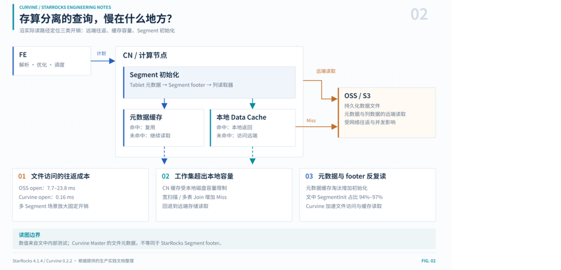
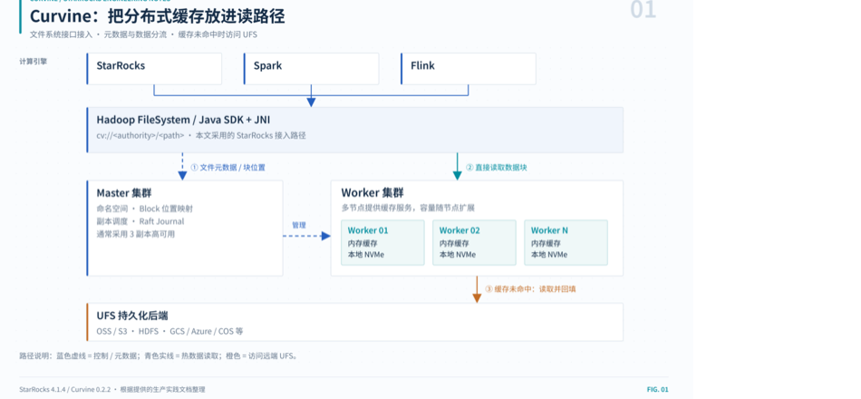
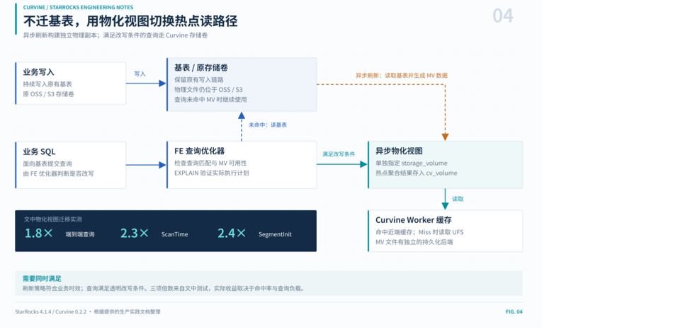
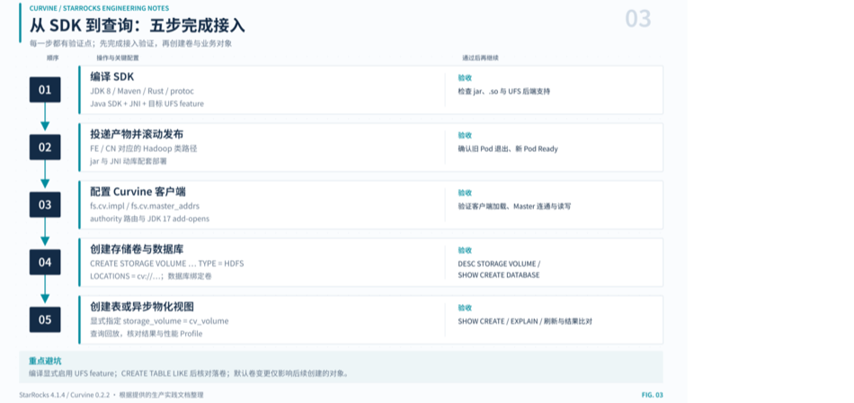

> 先看结果：把底层数据从对象存储迁到 Curvine 后，10 条生产慢查询总耗时从 **53.7 秒**降到 **16.8 秒**，整体提速 **3.2 倍**，单条最高 **3.8 倍**；单文件 open 从 **7.7～23.8 毫秒**降到 **0.16 毫秒**。没有改一行 SQL，没有魔改 StarRocks。而在基表无法迁移的场景，基于 Curvine 的异步物化视图同样拿到了端到端 **1.8 倍**、SegmentInit **2.4 倍**的提升。

<!-- truncate -->

| 指标 | 实测结果 |
| --- | --- |
| 10 条生产慢查询总耗时 | 53.7 s → **16.8 s** |
| 整体提速 | **3.2×** |
| 单条最高提速 | **3.8×** |
| 稳定提速区间 | 7 条查询落在 **3.4～3.8×** |
| 单文件 open 耗时 | 7.7～23.8 ms → **0.16 ms** |

*测试环境：StarRocks 4.1.4 + Curvine 0.2.2。数据来自生产集群内部测试，实际收益会随查询负载与缓存命中率变化。*

做大数据或 OLAP 架构的同学，近两三年大概都在评估或推进存算分离：冷热数据全丢进对象存储，成本低，计算节点还能按需弹性伸缩，再也不用为高峰期预留一堆昂贵的本地存储机型。

理想很美好。但当系统真正在生产环境承接复杂分析时，很多团队都会遇到一个反直觉的问题：

**数据明明放在了对象存储所谓的“高性能存储池”里，也加了本地缓存，为什么复杂的聚合与关联查询还是突然那么慢？**

我们在生产排查中发现，症结通常不在吞吐带宽，而在三笔极容易被忽视的隐性开销：**跨网络的高昂往返耗时、本地缓存容量的天花板，以及底层数据段（Segment）元数据的反复读取**。

这篇文章完整复盘我们是如何定位这三笔账，并用 Curvine 在真实生产场景里一步步落地的。

---

## 一、存算分离的“理想”与“现实”

在 StarRocks 存算分离体系里，FE 负责元数据与查询解析调度，CN 节点纯无状态负责计算并支持弹性伸缩。数据文件沉在远端对象存储，CN 本地仅靠一块 Data Cache 做读缓存。

这套架构把“计算弹性”解得很漂亮，却把所有的运行成本压在了数据读取链路（Read Path）上。当我们在对象存储上跑分析查询时，不得不面对三个天生的物理瓶颈。

## 二、查询究竟卡在哪：三笔隐性开销



*图：StarRocks 存算分离的读路径，以及三类隐性开销*

### 2.1 打开一个文件，比读取数据慢了上千倍

做分析引擎调优，直觉往往会误导人。很多人以为慢是因为从对象存储下载几十上百兆的数据耗费时间。但当我们在慢查询节点打出火焰图和详细 Trace 时，结果很让人吃惊：

- 在对象存储上，单次打开一个 Segment 文件的网络与握手开销高达 **7.7～23.8 毫秒**；
- 与之相对，后续真正读取一段列存数据的本地 I/O，可能仅仅耗费 **9.994 微秒**。

这意味着，仅仅“打开文件句柄”这一步，就比真正读取数据慢了**三个数量级**。我们生产实测换到 Curvine 之后，一次单文件 open 耗时只有 **0.16 毫秒**。

瓶颈从来不是内网带宽，而是每一次通过 HTTP/REST 协议访问远端存储时，无法避开的网络往返与握手延迟。如果一个大查询涉及几百个分片，光是把文件挨个“敲开”，十几秒就悄无声息地溜走了。

> 注：0.16 ms 为 Curvine Master 下发文件元数据的耗时，与 StarRocks Segment footer 读取不完全等价，这里仅用于说明数量级差异。

### 2.2 本地 Data Cache 装不下的业务爆发

有同学可能会问：CN 节点不是自带 Data Cache 吗？命中本地缓存不就绕开对象存储了吗？

理想很丰满，但现实是磁盘容量有上限。CN 本地盘的大小受制于硬件配置，Data Cache 容量被 `datacache_disk_size` 死死框住。

日常跑过滤条件苛刻、数据量几万行的点查或者窄扫描，本地缓存确实能罩得住。可一旦业务发起大范围时间扫描，或者多张千万级大表进行复杂关联，工作集（Working Set）瞬间把本地缓存挤爆。

一旦缓存击穿，查询就会无情地回退到远端存储。最要命的是，这种性能劣化的**隐蔽性极高**：线下拿小数据量单表验证，性能飞快；一到线上早高峰大宽表重查询，耗时立刻被拉长数倍。

### 2.3 容易被大家忽略的元凶：SegmentInit 与元数据争抢

如果前两笔开销还在意料之中，第三笔账则是我们在抓 Profile 时才真正揪出来的硬骨头。

在分析多条千万级大查询时，我们发现一个惊人一致的现象：**`SegmentInit` 居然占了总扫描耗时（ScanTime）的 94%～97%**。整个 Scan 阶段的大部分生命，不是在解压数据，也不是在投影计算，而是在一遍遍打开 Segment、解析 footer 信息。

为什么会这样？我们翻看 StarRocks 源码后，脉络变得异常清晰：

1. **每一个 Segment 冷打开，都必须拉取尾部元数据。** 查询引擎要读一个 Segment，至少要打两次远端存储：先读 `<tablet>_<version>.meta`，再拉取 16KB 的 footer 信息。StarRocks 源码的 `load_segment` 实现里就有这样的注释：

   ```cpp
   // segment->open will read the footer, and it is time-consuming
   ```

2. **CN 内部的元数据缓存上限只有 2GB，且无法扩容。** 在代码里，`lake_metadata_cache_limit` 被硬编码成了 `2147483648`（即 2GiB）。线上表稍微多一些、分区多一些，这个固定容量的小池子就长期处于打满状态。由于内存紧张，LRU 策略只能频繁把旧元数据剔出内存。**Miss 成了常态。**

这就导致了一笔极其残酷的算式：

> **查询开销 = 段数量 × 单次元数据访问延迟**

当一条重查询覆盖几百上千个 Segment 时，哪怕底层的列存数据块已经安稳躺在 Data Cache 里，为了“确认元数据”，引擎依然得老老实实地向远端发起上千次文件元信息拉取。

这三笔隐性开销，指向了同一个破局思路：**必须把文件抽象与冷热数据，统统从远端拉回近端。**

---

## 三、Curvine 到底扮演了什么角色？

先简单介绍下 Curvine，它是我们基于 Rust 打造的开源分布式缓存文件系统。在架构设计上，它做了一次很巧的“李代桃僵”：

- **向上**：暴露标准的 Hadoop `FileSystem` 接口（通过 `cv://` 协议 Scheme）；
- **向下**：把真正持久化的底仓委托给现有的底层存储（UFS，比如各家公有云的 OSS / S3，或者内部的 HDFS）。



*图：Curvine 把分布式缓存放进读路径，向上兼容 Hadoop 生态，向下对接 UFS*

核心角色分工如下：

| 组件 | 核心职责 |
| --- | --- |
| Master（通常 3 副本） | 管理文件命名空间、Block 块位置映射、副本调度与 Raft Journal 状态机持久化 |
| Worker（多节点，按需横向扩展） | 负责具体数据块的存储与高速读写，维护内存与本地 NVMe 的两级缓存 |
| UFS 后端 | 冷数据的最终归宿，支持 OSS / S3 / HDFS / GCS / Azure / COS / WebHDFS 等 |

对引擎层来说，最舒服的地方在于**生态透明**：它就是一个标准的存储卷，不需要魔改 StarRocks 源码就可以轻松接入。

针对前面三道难题，Curvine 的架构设计恰好提供了对位解答：

| 对象存储的现实痛点 | Curvine 的应对机制 | 生产实测验证 |
| --- | --- | --- |
| 网络往返延迟高 | 热数据直接沉淀在 Worker 本地高速 NVMe 盘，读取路径完全不触碰远端网络 | 单次 open 从 7.7～23.8 ms 压到 **0.16 ms** |
| 单机 Data Cache 容量受限 | 缓存层从“单机本地散装”变成“集群统一纳管”，容量随着 Worker 节点横向扩展 | 集群缓存池可线性外扩，大查询工作集不再轻易击穿 |
| 元数据频繁拉取开销大 | 文件元数据由 Curvine Master 通过内部 RPC 直接下发，避开对象存储低效的 LIST/HEAD 与多次 HTTP 请求 | SegmentInit 耗时降低 **2.4 倍** |

这里特别想展开提一句元数据的差异。

StarRocks 单机那 2GB 的元数据缓存是每个 CN 节点私有的，一旦超出只能淘汰；而 Curvine 的元数据收归 Master 管理，独立于单个计算节点存在。**这是从存储拓扑结构上的解耦，不是单靠在 StarRocks 配置文件里微调几个参数就能追平的。**

---

## 四、生产实测：用真实慢查询说话

为了验证实际提升，我们没用现成的标准基准测试套件，而是在生产业务库上直接调取了线上审计日志，从中挑选出日常耗时排名前 10 的真实慢查询。

这 10 条 SQL 都是千万行、多表关联且带复杂聚合的重查询，也是最能榨出底层 I/O 差异的场景。我们将底层数据迁至 Curvine 后，逐条在相同负载下进行严格回放对比（耗时单位：秒）：

| 序号 | OSS | Curvine | 实际提速倍数 |
| --- | --- | --- | --- |
| 01 | 6.322 | 1.693 | 3.7× |
| 02 | 6.149 | 1.653 | 3.7× |
| 03 | 6.094 | 1.669 | 3.7× |
| 04 | 6.454 | 1.923 | 3.4× |
| 05 | 6.129 | 1.661 | 3.7× |
| 06 | 6.543 | 1.894 | 3.5× |
| 07 | 7.425 | 2.727 | 2.7× |
| 08 | 1.249 | 1.119 | 1.1× |
| 09 | 0.863 | 0.782 | 1.1× |
| 10 | 6.487 | 1.726 | 3.8× |
| **总计** | **53.7** | **16.8** | **3.2×** |

十条生产慢查询的总耗时从 **53.7 秒直降到 16.8 秒**，整体提速达到 **3.2 倍**。其中有 7 条查询的提速倍数稳定在 **3.4～3.8 倍**之间。

为什么提速这么明显？答案就在于**单次开销的积少成多**。一条重 SQL 下发下来，拆解成上千个 Segment 的并发打开。在远端对象存储上，光打开文件就要花掉好几秒；而在 Curvine 毫秒级打开的加持下，I/O 准备时间被压缩到了近乎可以忽略的水平。

---

## 五、基表不敢动？用异步物化视图吃满红利

在生产环境中，核心基表体量极为庞大，上游每分每秒都有实时写入，根本不允许你停机或者全量把表挪到新存储卷上。

针对这种“基表不能碰、性能又被催”的典型痛点，我们摸索出了一套低侵入的平滑解法：**建一个基于 Curvine 存储卷的异步物化视图**。

基表依然在原来的 OSS/S3 卷上安心接写入，而物化视图的物理文件则直接指定落到 Curvine 卷上。StarRocks 强大的透明改写引擎在捕获到匹配的聚合查询时，会自动路由到物化视图——换句话说，**基表一行代码不用动，读路径却悄然切换成了 Curvine 高速链路**。



*图：基表留在原卷，异步物化视图把热点读路径切到 Curvine*

我们将业务侧体量最大的一张异步物化视图迁移到了 Curvine 存储卷，实测收益非常惊艳：

| 性能指标 | 相比于原远端卷的提升 |
| --- | --- |
| 端到端查询耗时（中位数） | 快 **1.8 倍** |
| ScanTime 扫描时间 | 快约 **2.3 倍** |
| SegmentInit 文件初始化 | 快约 **2.4 倍** |

注意看提升分布：最大的改善正是集中在 `SegmentInit` 阶段。这与我们前面推导的结论严丝合缝——当数据范围收敛后，元数据寻址本身就是最大的包袱，而 Curvine 恰好打在了七寸上。

建 MV 的核心 DDL 如下：

```sql
CREATE MATERIALIZED VIEW my_db.mv_on_cv
DISTRIBUTED BY HASH(user_id) BUCKETS 9
REFRESH MANUAL                              -- 生产建议初期手动触发，避开业务波峰
PROPERTIES (
    "replication_num" = "1",
    "storage_volume" = "cv_volume"          -- 关键：把物化视图物理文件指定到 CV 卷
)
AS
SELECT
    dt,
    user_id,
    count(1) AS pv,
    sum(price) AS total_gmv
FROM oss_db.huge_base_table
GROUP BY dt, user_id;
```

几个关键机制值得记下来：

- 异步物化视图**完整支持 `storage_volume` 属性**，这一行为已在生产环境中反复验证；
- 它的默认规则很明确：若未指定该属性，继承当前所属库的默认卷；但它**绝对不会错误地顺从基表所在的存储卷**；
- 普通逻辑视图（`CREATE VIEW`）本质只是 SQL 宏，不存在物理实体，因此不支持也不会生效该属性；
- 构建完成后，通过 `REFRESH MATERIALIZED VIEW ... WITH SYNC MODE` 进行单次物化同步，耗时大多在几十秒内完成。之后的聚合查询便会自动透明命中高速路径。

---

## 六、动手落地：从编译到全链路踩坑实录

原理通了，效果也有了，接下来介绍怎么一步步落地。这套流程我们前前后后在测试和生产集群完整滚过多次。**请务必按照顺序推进，跳过任何一步校验，后面基本都会遭遇折返跑。**



*图：从编译 SDK 到建表查询的五步接入流程，每一步都设有验收点*

### 6.1 先选对模式：`fs_mode` 还是 `cache_mode`

在将 StarRocks 对接 Curvine 时，需要明确区分客户端接入特点与底层 UFS 挂载/写入模式：

- **`cache_mode`（缓存模式）**：以“读加速与轻量缓存”为核心，将 Curvine 作为底层对象存储（OSS/S3）的高性能分布式缓存层。读优先检查本地多级缓存（Memory/NVMe SSD），未命中透明回源；写不强求严格同步。适用于以读为主、数据源已存在于对象存储中、主要希望借助 NVMe 加速读性能的场景。
- **`fs_mode`（文件系统/存储卷模式）**：以“独立文件系统与强一致存储卷”为核心，Curvine 作为主存储或全功能存储卷，通过后台 journal 驱动的 export 机制与底层 UFS 保持生命周期同步。读支持一致性校验与 fallback；写优先写入 Curvine 并持久化回 UFS，确保持久化保障。适用于类似 StarRocks 的存算分离高性能数仓场景，作为高频读写、多维分析及数据导入的主存储卷。

在 Curvine 中挂载远端对象存储（`cv mount`）：

```bash
bin/cv mount "oss://my-hdfs/starrocks/" "/my-hdfs/starrocks" \
  --provider oss \
  --config oss.endpoint=cn-beijing.oss-dls.aliyuncs.com \
  --config oss.accessKeyId=YOUR_ACCESS_KEY_ID \
  --config oss.accessKeySecret=YOUR_ACCESS_KEY_SECRET
```

### 6.2 源码准备

```bash
git clone https://github.com/CurvineIO/curvine curvine
cd curvine
```

### 6.3 编译 Java SDK

第一步是打出供 StarRocks FE/CN 调用的 Java SDK 和底层 JNI 动态库。

环境要求：

- JDK 8（编译用）
- Maven ≥ 3.8.1
- Rust 完整工具链（Cargo）
- `protoc` 编译器

```bash
# 构建支持底层 OSS 的客户端
make build ARGS='--package java --ufs oss'
```

编译完成后，会在输出目录得到两类关键产物：

| 产物名称 | 用途说明 |
| --- | --- |
| `curvine-hadoop-*.jar` | 上层调用的 Java SDK 接口包 |
| `libcurvine_libsdk_<os>_<arch>_64.so` | 底层 Rust JNI 原生动态链接库 |

这里还有个小细节：JNI 动态库文件名是由 `CurvineNative.getLibraryName()` 动态决定的，它会读取宿主机 `/etc/os-release` 里的操作系统标识和主版本号（例如 `libcurvine_libsdk_centos7_x86_64.so` 或 `libcurvine_libsdk_alinux3_x86_64.so`）。

`.so` 文件必须与 `jar` 包放置在**同级目录**下，或者确保其所在路径被包含在 `java.library.path` 之中。

### 6.4 投递产物到 StarRocks 镜像

产物就绪后，需要将其注入到 StarRocks 运行镜像中。主要覆盖以下目录（根据实际部署架构而定，下面以 4.1.4 为例）：

| 放置路径 | 服务类型与用途 |
| --- | --- |
| `StarRocks-4.1.4/fe/lib/` | FE 节点，用于解析与加载 Hadoop FS 元数据 |
| `StarRocks-4.1.4/cn/lib/hadoop/common/` | CN 节点，存算分离核心数据读写路径 |

### 6.5 联通配置：让 StarRocks 认识 Curvine

镜像跑起来后，需要告知 StarRocks 该如何与 Curvine 集群对话。在 FE 和 CN 的 `core-site.xml`（或容器平台的 `hadoop-conf` ConfigMap）中追加以下配置：

```xml
<configuration>
    <!-- 注册 Curvine 标准 FileSystem 实现 -->
    <property>
        <name>fs.cv.impl</name>
        <value>io.curvine.CurvineFileSystem</value>
    </property>

    <!-- 注册 Curvine AbstractFileSystem 实现 -->
    <property>
        <name>fs.AbstractFileSystem.cv.impl</name>
        <value>io.curvine.CurvineAbstractFileSystem</value>
    </property>

    <!-- 配置指定集群名称的 Master 地址列表（对应 cv://URI 中的 authority） -->
    <property>
        <name>fs.cv.curvine-pro.master_addrs</name>
        <value>master-0:8995,master-1:8995,master-2:8995</value>
    </property>
</configuration>
```

这里的寻址逻辑分为两个层次，配置时务必留心：

- `fs.cv.master_addrs` 是全局默认的 Master 地址池；
- `fs.cv.<authority>.master_addrs` 则是针对特定 Authority 的定制路由。例如你的卷路径是 `cv://curvine-pro/...`，客户端会优先匹配 `fs.cv.curvine-pro.master_addrs`，若不存在才会退回全局项。因此**配置项的键名一定要和后续 SQL 建卷的 Authority 严格对齐**。

推荐的客户端运行参数调优参考：

```xml
<!-- 客户端并发与工作线程配置 -->
<property>
    <name>fs.cv.io_threads</name>
    <value>16</value>
</property>
<property>
    <name>fs.cv.worker_threads</name>
    <value>32</value>
</property>

<!-- 块大小与并发读取分片 -->
<property>
    <name>fs.cv.block_size</name>
    <value>128MB</value>
</property>
<property>
    <name>fs.cv.read_parallel</name>
    <value>1</value>
</property>

<!-- 客户端工作模式 -->
<property>
    <name>fs.cv.enable_unified_fs</name>
    <value>true</value>
</property>
<property>
    <name>fs.cv.enable_rust_read_ufs</name>
    <value>false</value>
</property>
```

> **⚠️ JDK 17 的反射壁垒**
>
> StarRocks 4.x 的 FE 普遍运行在 JDK 17 上。由于 JNI 底层涉及对 `DirectByteBuffer` 等底层对象的反射，必须在 FE 的 JVM 启动参数中显式添加开放指令：`--add-opens=java.base/java.nio=ALL-UNNAMED`。
>
> 若仍遇到反射相关的访问异常，可一并加上 `--add-opens=java.base/java.util=ALL-UNNAMED`。否则启动时会毫不留情地抛出 `InaccessibleObjectException` 或 `Could not initialize class io.curvine.CurvineNative`。

### 6.6 创建存储卷与数据库

一切配置生效后，我们就可以通过标准的 SQL 语法将 Curvine 注册为一个可用的存储卷了。

存储卷的 `LOCATIONS` 路径由三段构成：`cv://<authority>/<UFS 挂载路径>/<集群标识>`。示例中 authority 为 `curvine-pro`：

```sql
-- 1. 创建基于 Curvine 的通用存储卷
CREATE STORAGE VOLUME cv_volume TYPE = HDFS
LOCATIONS = ('cv://curvine-pro/starrocks')
PROPERTIES ("enabled" = "true");

-- 2. 创建关联该卷的数据库
CREATE DATABASE my_db PROPERTIES ("storage_volume" = "cv_volume");
```

StarRocks 会在指定目录下自动追加当前集群的全局唯一 UUID，因此即使多个分析集群挂载同一个 Curvine 根路径，数据之间也能实现良好的物理隔离。

> 注：以上挂载路径与卷路径仅为示例，请按实际的 Curvine 命名空间与挂载点调整。

建好后随手执行校验，养成良好习惯：

```sql
SHOW STORAGE VOLUMES;
DESC STORAGE VOLUME cv_volume;   -- 重点核对 Location 与 Type
SHOW CREATE DATABASE my_db;      -- 确认默认 storage_volume
```

> **工程经验**：不要图省事随手去执行 `SET ... AS DEFAULT STORAGE VOLUME` 改动集群级默认卷。改动数据库或集群默认卷**只对后续新建的表生效**，现存存量表绝不会凭空自动重定向。

### 6.7 建表实战与“继承陷阱”

现在可以正式创建数据表了：

```sql
CREATE TABLE my_db.t (
    id BIGINT NOT NULL,
    name VARCHAR(64) NULL
) ENGINE=OLAP
DUPLICATE KEY(id)
DISTRIBUTED BY HASH(id) BUCKETS 12
PROPERTIES (
    "replication_num" = "1",
    "storage_volume" = "cv_volume"
);
```

建表完成后务必用 `SHOW CREATE TABLE my_db.t` 确认回显中含有 `"storage_volume" = "cv_volume"`。

> **⚠️ 冷门陷阱：`CREATE TABLE ... LIKE` 的卷继承**
>
> 很多同学做测试喜欢用 `CREATE TABLE t_new LIKE t_old` 快速复制表结构。请特别注意：`LIKE` 语句会**完整继承老表的 `storage_volume` 属性**！如果老表原本落在 OSS 上，即使你的目标数据库默认卷是 `cv_volume`，新复制出来的表依然会被固化在老 OSS 卷上。要迁移表结构，要么老老实实手写建表 DDL，要么显式指定 `PROPERTIES`。

### 6.8 最佳实践：不动基表，靠物化视图完成平滑提速

前面反复提到，这招是整个落地实践中最优雅、业务阻力最小的战术，DDL 与机制见本文第五节。这里只强调落地顺序：

1. 先确认异步物化视图的透明改写已生效（用 `EXPLAIN` 验证执行计划）；
2. 初次刷新建议手动触发，避开业务波峰；
3. 单次同步完成后，再逐步交给调度；
4. 全程观察 FE/BE 指标与查询命中情况，确认无回退。

---

## 七、总结：把冷数据留在远端，把热数据拉回近端

走完这趟探索，我们沉淀了四个关于存算分离与性能平衡的明确结论：

1. **复杂慢查询的提速是实打实的。** 在生产级别千万行多表关联场景下，10 条最耗时的慢查询从 53.7 秒整体收敛至 16.8 秒（整体提速 3.2 倍，单条最高达 3.8 倍）。如果配合一次全表 Compaction，耗时还能进一步压降。这说明合理的文件合并整理与存储介质加速可以实现良性叠加。
2. **物化视图是核心资产平滑加速的最优解。** 当基表由于数据体量大、实时写入链路复杂而无法轻易变动时，把热点计算收拢到基于 Curvine 的异步物化视图上，端到端能斩获至少 1.8 倍的稳定提速，既稳妥又见效快。
3. **架构改造成本极低。** Curvine 抽象出的 `cv://` 在上层看完全就是标准的 HDFS 语义，建库、建卷、建表全走纯粹的 SQL，引擎内核不需要任何侵入式修改。
4. **底层硬件底气：亚毫秒级 Open 与零错误率。** 将单文件打开耗时从对象存储的十多毫秒压制到 0.16 毫秒，彻底抚平了分析引擎在元数据与段扫描上的先天短板。

### 生产选型路径推荐

如果你的团队也在被存算分离的查询性能所困扰，建议按以下节奏分步推进：

- **全新搭建的业务库/分析表**：直接挂载在 Curvine 存储卷上，建表时用 `SHOW CREATE` 确认生效；
- **历史核心沉重基表**：千万别硬迁，优先针对高频分析场景构建基于 CV 存储卷的异步物化视图；
- **排查现有性能劣化**：在急着归档存储之前，先查表内健康度（是否存在大量未合并的小文件、历史版本与死数据），把 Compaction 做好；
- **终极极致性能**：整表健康合并治理 + 数据落地 Curvine，两手一起抓。

**把冷数据留在远端，把热数据与元数据拉回近端**——这几乎是存算分离演进史上最自然也最见效的一次性能回归。而 Curvine 的价值，就是让这一切的发生，变得足够平滑和安静。

---

> **关于 Curvine**
>
> Curvine 是一个基于 Rust 构建的开源分布式缓存文件系统：向上通过 `cv://` 暴露标准 Hadoop FileSystem 接口，向下对接 OSS / S3 / HDFS 等 UFS，为存算分离场景提供近端高速缓存与统一元数据管理。

*本文基于 StarRocks 4.1.4 + Curvine 0.2.2 的生产实践整理。项目地址：[github.com/CurvineIO/curvine](https://github.com/CurvineIO/curvine)*
