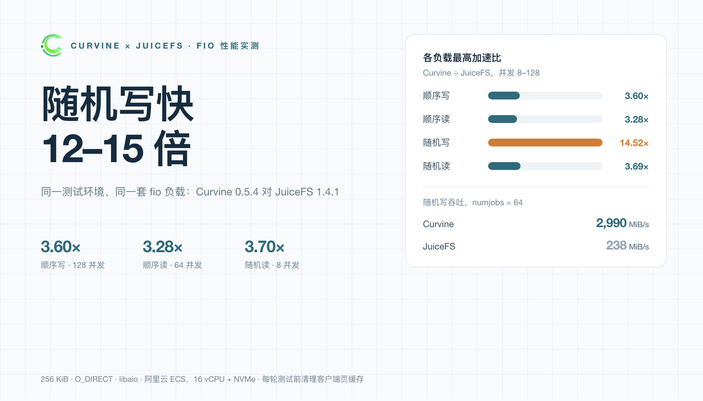
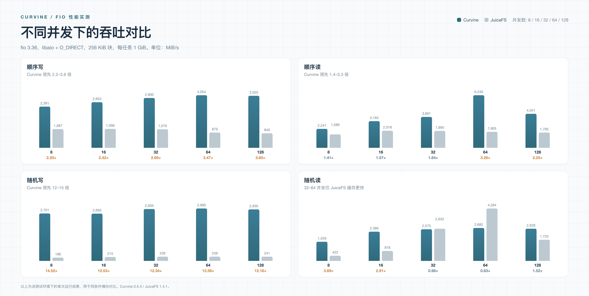
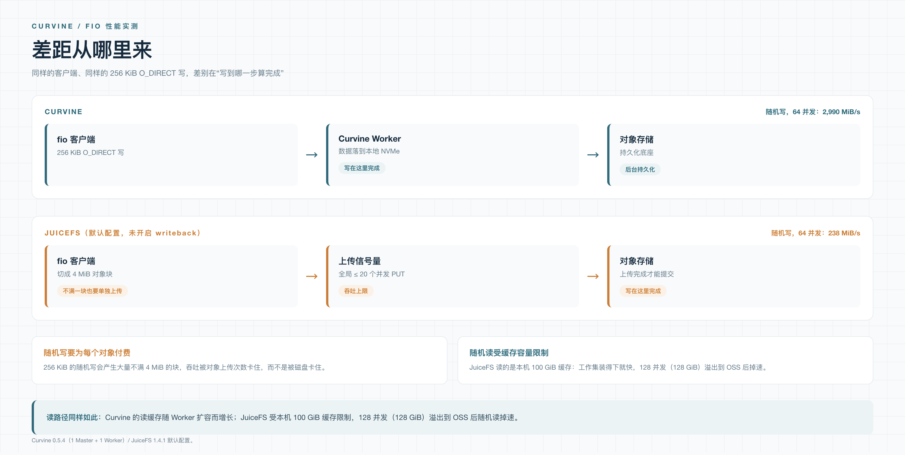

> 先看结果：同一台测试机、同一套 fio 配置（256 KiB、`libaio` + `O_DIRECT`、8～128 并发任务），Curvine 0.5.4 在 **20 组数据里领先 18 组**。差距最大的是**随机写：12～15 倍**（64 并发下 2,990 对 238 MiB/s），顺序写最高 **3.6 倍**，顺序读最高 **3.3 倍**。JuiceFS 赢的两组都是随机读——32 和 64 并发时，它的 100 GiB 本地缓存正好装得下整个工作集。

<!-- truncate -->

两个系统都在对象存储之上提供 POSIX 文件系统，也都常被当作数据湖和 AI 流水线前面的缓存层。真正的差别在于：一次写，写到哪一步才算完成。下面把数据、环境和读写路径摊开讲。

## 一、测试怎么做的

| 项目 | 配置 |
| --- | --- |
| 节点 | 阿里云 ECS，16 vCPU，123 GiB 内存，内核 6.8.0-88，3.5 TiB NVMe 数据盘 |
| Curvine | 开源版 0.5.4；1 Master + 1 Worker + 1 Client，使用上述机型；数据由 Worker 的 NVMe 提供 |
| JuiceFS | 开源版 1.4.1；元数据用单台 Redis；数据后端为阿里云 OSS 内网 bucket，对象块 4 MiB；客户端缓存 100 GiB（`--cache-size=102400`） |
| 缓存清理 | 每组测试前执行 `sync; echo 3 > /proc/sys/vm/drop_caches`，只清客户端，Worker 和 OSS 侧缓存不受影响 |
| 压测工具 | fio 3.36，`libaio` + `O_DIRECT`，256 KiB 块，每任务 1 GiB |

两侧元数据缓存均为默认配置。读测试复用相同并发下写测试生成的文件。

```bash
# 顺序写
fio --name=seq_write --directory=<mount>/fio-test \
    --ioengine=libaio --direct=1 --bs=256k --size=1g --rw=write \
    --group_reporting --numjobs=<8|16|32|64|128> --end_fsync=1

# 随机写
fio --name=rand_write --directory=<mount>/fio-test \
    --ioengine=libaio --direct=1 --bs=256k --size=1g --rw=randwrite \
    --group_reporting --numjobs=<8|16|32|64|128> --end_fsync=1
```

读测试把 `--rw` 换成 `read` / `randread`，并加 `--allow_file_create=0`。`end_fsync=1` 是刻意加的：一轮跑完必须等数据落盘才算数。

## 二、吞吐结果

吞吐单位均为 MiB/s。倍数 = Curvine ÷ JuiceFS，大于 1 表示 Curvine 更快。



*图 1：8、16、32、64、128 并发下的顺序与随机吞吐，单位 MiB/s。*

### 2.1 顺序写：2.2～3.6 倍

| numjobs | Curvine | JuiceFS | Curvine ÷ JuiceFS |
| ---: | ---: | ---: | ---: |
| 8 | 2,391 | 1,087 | 2.20× |
| 16 | 2,653 | 1,096 | 2.42× |
| 32 | 2,900 | 1,079 | 2.69× |
| 64 | 3,054 | 879 | 3.47× |
| 128 | 3,025 | 840 | 3.60× |

Curvine 的吞吐随并发上升，64 并发之后稳定在 3 GiB/s 左右。JuiceFS 在 8～32 并发维持在 1.1 GiB/s，之后回落到 840～880 MiB/s。并发越高，差距越大。

### 2.2 顺序读：1.4～3.3 倍，峰值 6,240 MiB/s

| numjobs | Curvine | JuiceFS | Curvine ÷ JuiceFS |
| ---: | ---: | ---: | ---: |
| 8 | 2,241 | 1,586 | 1.41× |
| 16 | 3,163 | 2,018 | 1.57× |
| 32 | 3,661 | 1,995 | 1.84× |
| 64 | 6,240 | 1,905 | 3.28× |
| 128 | 4,041 | 1,795 | 2.25× |

这一组 JuiceFS 读的是本机 100 GiB 缓存，Curvine 读的是 Worker 的 NVMe。Curvine 在每个并发档位仍然领先，64 并发峰值达到 6,240 MiB/s。

### 2.3 随机写：12～15 倍

| numjobs | Curvine | JuiceFS | Curvine ÷ JuiceFS |
| ---: | ---: | ---: | ---: |
| 8 | 2,701 | 186 | 14.52× |
| 16 | 2,693 | 215 | 12.53× |
| 32 | 2,950 | 239 | 12.34× |
| 64 | 2,990 | 238 | 12.56× |
| 128 | 2,930 | 241 | 12.16× |

这是差距最大的一组。Curvine 的随机写吞吐（2.7～3.0 GiB/s）和它的顺序写几乎一样，说明 256 KiB 的随机写在 Curvine 上几乎没有额外开销。JuiceFS 停在 186～241 MiB/s，不到它自己顺序写的四分之一。

### 2.4 随机读：缓存容量决定胜负

| numjobs | Curvine | JuiceFS | Curvine ÷ JuiceFS |
| ---: | ---: | ---: | ---: |
| 8 | 1,559 | 422 | 3.70× |
| 16 | 2,380 | 818 | 2.91× |
| 32 | 2,575 | 2,632 | 0.98× |
| 64 | 2,682 | 4,284 | 0.63× |
| 128 | 2,628 | 1,725 | 1.52× |

这一组要一行一行看：

- **8、16 并发**：Curvine 分别领先 3.70 倍和 2.91 倍。
- **32 并发**：基本持平，JuiceFS 高约 2%。
- **64 并发**：JuiceFS 达到 4,284 MiB/s，是 Curvine 的 1.6 倍。此时读工作集是 64 GiB，能完全放进 100 GiB 本地缓存，请求根本不出本机。
- **128 并发**：工作集涨到 128 GiB，溢出缓存。JuiceFS 掉到 1,725 MiB/s，Curvine 重新领先 1.52 倍。

Curvine 在 16～128 并发之间稳定在 2.4～2.7 GiB/s，几乎是一条水平线。

## 三、差距从哪里来



*图 2：一次 256 KiB 的写，在哪一步算完成，决定了吞吐。*

### 3.1 写落在 Worker，而不是落在对象存储

在这套部署里，Curvine 客户端把数据块发给 Worker，直接落到本地 NVMe，对象存储是它背后的持久化底座。Worker 拿到数据，这次写就完成了。

JuiceFS 在默认配置下（`--writeback` 关闭）把文件切成 4 MiB 对象块 PUT 到 OSS。上传信号量是客户端全局的，默认 20 个并发 PUT（`--max-uploads`）；再加上 `end_fsync=1`，每一轮都要等上传完成、元数据提交，才算跑完。

这个差别在随机写上最明显。在文件中间随机写 256 KiB，会产生一个不满 4 MiB 的块，而不满的块同样是一个独立对象、一次独立 PUT。于是吞吐被对象操作次数卡住，而不是被磁盘卡住。顺序写时这些写会合并成完整的 4 MiB 块，所以 JuiceFS 从顺序写的 1.1 GiB/s 掉到随机写的 240 MiB/s 左右；而 Curvine 始终按 NVMe 的速度写，两种模式几乎没有差别。

### 3.2 读受缓存容量限制

随机读是相反的故事。JuiceFS 读的是本机 100 GiB 缓存，只要工作集装得下，本地缓存很难被打败：32 GiB、64 GiB 都装得下，吞吐一路涨到 4,284 MiB/s。到 128 GiB 装不下了，未命中回源 OSS，吞吐直接腰斩。

Curvine 的读缓存放在 Worker 层，容量随集群扩容，而不是被单机磁盘锁死。这次测试里客户端是跨网络读单个 Worker 的，曲线仍然在 16～128 并发之间保持在 2.4～2.7 GiB/s。

### 3.3 高并发下的可预期性

顺序写、随机写、随机读三组里，Curvine 从 32 到 128 并发几乎是水平的。JuiceFS 在顺序写的 64 并发、随机读的 128 并发都出现了明显回落。对几百个进程同时打存储的训练任务或 Agent 平台来说，并发上来之后性能不掉，比单点峰值更重要。

## 四、对 AI 负载意味着什么

- **写 checkpoint**：checkpoint 就是一波大块顺序写，2.2～3.6 倍的顺序写领先，直接换成 GPU 少空转的时间。
- **数据预处理与 shuffle**：随机写多、元数据多，12～15 倍的随机写优势会改变一个预处理阶段的耗时。
- **Agent 工作区**：大量小文件反复改写，随机写和顺序写几乎等价这一点才是关键。
- **读密集分析**：工作集能装进本地缓存时，JuiceFS 很有竞争力，单客户端下随机读甚至更快。Curvine 的价值在于缓存放在集群里，可以加 Worker 扩容，而不是被一台机器的磁盘封顶。

## 五、关于这组数据的说明

比起夸大结果，我们更愿意把边界讲清楚：

1. 所有结果都是同一测试机上的**单次运行**，用于同条件横向对比，不代表两个系统的性能上限。
2. 两侧用的是**各自的默认部署形态**：Curvine 数据落在 Worker NVMe，JuiceFS 持久化到 OSS 并使用本地读缓存。这个差别是真实存在的，也正是本文在测的东西；但也意味着这不是一个"客户端与 Worker 跨机房部署"的 Curvine 测试。
3. Curvine 只有 **1 Master + 1 Worker**，是最小规模。聚合吞吐随 Worker 数量增长，本次没有做加节点测试。
4. **没有测 JuiceFS 的 writeback 模式**。打开 `--writeback` 会把上传移出写路径，写差距会明显收窄；但对象块仍是 4 MiB，随机写的差距预计会缩小而不会消失。
5. 两侧**元数据缓存都用默认值**，并且使用同一个 fio 二进制、同样的客户端缓存清理方式。

## 六、结论

| 测试项 | 结论 |
| --- | --- |
| 顺序写 | Curvine 领先 2.2～3.6 倍（128 并发：3,025 对 840 MiB/s） |
| 顺序读 | Curvine 领先 1.4～3.3 倍（64 并发峰值：6,240 对 1,905 MiB/s） |
| 随机写 | Curvine 领先 12～15 倍（2,701～2,990 对 186～241 MiB/s） |
| 随机读 | 8/16 并发 Curvine 领先 3.7/2.9 倍；32 并发持平；64 并发 JuiceFS 缓存更快；128 并发 Curvine 领先 1.5 倍 |

20 组数据里，Curvine 领先 18 组、落后 2 组。最能体现优势的是写密集和高并发负载：checkpoint、数据预处理、Agent 工作区。

Curvine 采用 Apache-2.0 协议，代码在 [github.com/CurvineIO/curvine](https://github.com/CurvineIO/curvine)。部署方式和更多基准测试见 [curvineio.github.io](https://curvineio.github.io/docs/Overview/instroduction)。

*测试环境：Curvine 0.5.4 / JuiceFS 1.4.1，阿里云 ECS 16 vCPU + 3.5 TiB NVMe。结果与环境强相关，上线前请用上面的命令在自己的环境复测。*
