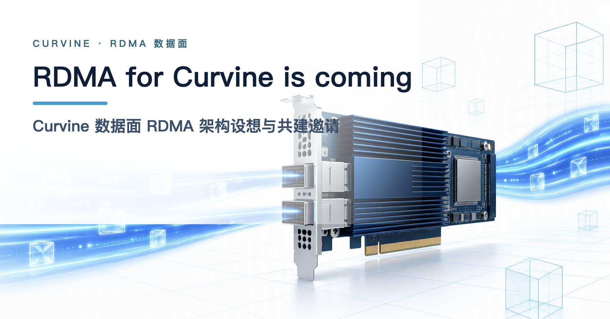

> 先看结论：控制面继续跑 TCP，块数据面迁到 one-sided RDMA，所有通信库藏在同一套可插拔后端接口之后。libfabric 作为主后端，UCX 面向 GPU/HPC 场景可选，原生 verbs 保留为性能基线与私有化备选，任何路径都可回退 TCP。这是一份公开设计讨论稿，欢迎拍砖与共建。

<!-- truncate -->

## 一、当 GPU 在等数据，数据在等协议栈

过去两年，存储系统面对的世界变了。

大模型训练要喂 checkpoint，推理集群要拉向量索引，大数据作业要 shuffle 海量中间结果，AI 应用背后的 LanceDB、Milvus 们要一遍遍扫描几十 GB 的向量文件。这些负载有一个共同点：**带宽敏感、延迟敏感、而且越来越穷凶极恶**。

Curvine 作为面向 AI 与大数据场景的分布式缓存文件系统，一直在数据通路上抠性能：

- **自研 ORPC**：22 字节定长协议头 + protobuf 业务头 + 裸数据段，req_id 多路复用，一连接内并发跑流；
- **零拷贝**：Linux 下 sendfile / splice 把"文件到 socket"的拷贝交给内核，Worker 读盘直发网卡；
- **SPDK 块设备**：绕过内核块层，NVMe-oF 直达盘；
- **三阶段块流**：Open → Running → Complete，把大块读写做成可流水、可重试的流式协议。

但当我们把单机带宽推到 100G、200G 甚至 400G 时，一个新的瓶颈浮出水面：**TCP/IP 协议栈本身**。

每一次块传输，数据要经历系统调用、用户态/内核态切换、socket 缓冲拷贝、软中断处理。CPU 被协议栈吃掉，内存带宽被拷贝吃掉，而真正的业务——磁盘和网卡——反而在等。

一句话：不是 Curvine 不够快，而是块数据的高速公路，还差最后一条"免检通道"。

这条通道，叫 RDMA。

## 二、RDMA 的三个世界

RDMA 不是一个库，而是一族能力。过去几年，生态里真正被行业广泛使用的通用用户态 RDMA 通信库，其实只有三个 API 家族。

| 方案 | 一句话定位 | 优势 | 代价 |
| --- | --- | --- | --- |
| libibverbs + rdma_cm | 最底层的原生 API | 零抽象开销、功能最全、延迟上限最高 | 连接管理、QP 状态机、GID 选择全部自己写，工程量最大 |
| libfabric (OFI) | fabric 统一抽象层 | 一套 API 通过 provider 覆盖 verbs、rxm、EFA、PSM、CXI、TCP | API 概念多，学习曲线陡 |
| UCX | 传输 × 协议框架 | 性能天花板（NCCL/MPI 底座）、GPUDirect、多网卡自动选择 | 依赖与配置重，对纯存储场景偏"牛刀杀鸡" |

除此之外，还有几类"看起来像选项"的东西：rsocket 这类 socket 兼容层（接入最快，但性能与语义受限）、MPI / Mercury / Margo 这类高层通信框架（编程模型是集合通信，不适合 client-server 存储）、以及 NVMe-oF/RDMA、NFS-RDMA、SMB Direct 这类专用线上协议（Curvine 的 SPDK 后端已经在用 NVMe-oF，但它的语义替代不了文件系统数据面）。

一句话总结：**通用通信库约等于三个家族，加上三类封装与专用协议；能作为 Curvine 长期后端的，只有前两个半。**

## 三、为什么是 libfabric

在公开讨论中，我们给出的选型结论是：

> **libfabric 作为主后端，UCX 作为 GPU/HPC 场景的可选后端，原生 verbs 作为性能基线与私有化备选，控制面保留 TCP。**

选择 libfabric，有四个理由。

**第一，provider 模型天然解决"多库适配"。** libfabric 自己不实现 RDMA，它定义一套统一的 `fi_*` 接口，由各家 provider 落地：Mellanox 的 verbs provider、AWS 云上的 EFA provider、Intel 的 PSM provider、HPE Cray 的 CXI provider，甚至纯软件的 tcp / shm provider。适配一次 libfabric，等于同时拿到了大部分厂商的网卡，而不是为每一家维护一条代码路径。

**第二，编程模型与 ORPC 严丝合缝。** libfabric 的 tagged message 用一个 64 位 tag 做消息匹配，可以直接映射 ORPC 的 req_id；`fi_write` / `fi_read` 提供 one-sided RMA，正是块数据零拷贝需要的原语。

**第三，存储行业已经验证过。** DAOS 的 CaRT 通信层、AWS EFA 上的大规模存储流量，都跑在 libfabric 上。这不是实验室里的技术。

**第四，FFI 维护成本最低。** 我们只需要自建一个 `libfabric-sys` 绑定；换成 UCX，API 面和配置组合要大一个数量级，长期维护成本不可同日而语。

什么时候应该翻转这个选择？如果你跑的是纯 NVIDIA RoCE 集群、需要 GPU 显存直连（GPUDirect），UCX 是更好的答案；如果是单厂商私有化部署、要求微秒级小消息，裸 verbs 更合适。

**而这，正是我们要做框架的原因——让这个选择是一个配置项，而不是一次重构。**

## 四、Curvine 的 RDMA 架构设想

### 4.1 一个大原则：分平面，渐进式

我们不打算把整条 RPC 栈推倒重来。设想中的第一版是"分平面"：

- **控制面继续跑 TCP**：元数据 RPC 小而零散，TCP 的几十微秒延迟不是瓶颈，改造成本却很高；
- **数据面单独走 RDMA**：块读写是"大块、顺序、客户端主导"的流量，正好是 one-sided RDMA 的最优形态。

这样做还有一个隐藏福利：现有的 `DataSlice::MemSlice` 类型和 BlockIO 抽象已经存在，RDMA 落进注册内存的数据，可以原样喂给存储层——和今天 SPDK 后端的对接方式一模一样。

整体架构分四层：

```
Application   FsWriter / FsReader / BlockClient / Replication
     |
Data plane    RdmaDataChannel (rendezvous)
     |
Abstraction   backend registry / capability negotiation / MR pool / CQ pump
     |
Backends      libfabric | UCX | verbs | TCP passthrough
```

抽象层是一个独立 crate，永远可编译——macOS 开发机上只有 TCP passthrough；各 RDMA 后端以 feature 的方式按需启用，缺依赖时编译期报错，默认构建完全不受影响。

### 4.2 抽象"操作"，而不是抽象"寄存器"

把 verbs 的 post_send / poll_cq 直接抽象出来是个陷阱——那是 verbs 方言，libfabric 和 UCX 的语义并不一样。我们抽象的是**操作语义 + 能力声明**：

```rust
pub struct Capabilities {
    pub one_sided_write: bool,
    pub one_sided_read: bool,
    pub tagged_msg: bool,
    pub max_msg_size: usize,
    // ...
}

pub trait RdmaConn: Send {
    /// Opaque handshake bytes: verbs carries QPN/GID,
    /// libfabric carries its connect blob, UCX carries the worker address.
    fn local_handshake(&self) -> Vec<u8>;
    fn establish(&mut self, peer: &[u8]) -> Result<()>;

    fn send(&self, ...) -> Result<()>;
    fn recv(&self, ...) -> Result<()>;
    fn write_remote(&self, ..., token: RemoteToken) -> Result<()>;
    fn read_remote(&self, ..., token: RemoteToken) -> Result<()>;
}
```

三个关键设计：

- **不透明握手**：抽象层不关心连接语义，只负责搬运一段字节。连接建立复用现有 ORPC 通道做 bootstrap，交换 backend、能力、握手 blob 和会话 nonce；
- **能力协商**：不支持 one-sided 的后端自动降级为 two-sided 模拟，上层逻辑零感知；
- **插件化**：先做编译期 feature，后续支持 dlopen 加载 C ABI 插件，让厂商私有 SDK（比如国产网卡、智能网卡）不改代码即可接入。

### 4.3 一条数据是怎么走完的

写路径，客户端主动 WRITE：

```
BlockClient                     Worker
  |-- OpenBlock (TCP control) ---->|
  |<-- AllocToken(rkey, addr) -----|  carve a landing buffer from the MR pool
  |== RDMA WRITE_WITH_IMM ========>|  zero-copy into MR, completion queues persistence
  |-- Complete (TCP control) ------>|
```

读路径，Worker 主动 WRITE 到客户端注册好的接收缓冲：

```
Client: ReadBlock{ recv_token, credits }  --->  Worker
Worker: disk read -> registered MR -> RDMA WRITE -> Client MR -> FUSE
```

吞吐与流控由"信用（credits）+ inflight 上限"控制，接收端随时可以踩刹车。

这里必须诚实：**磁盘到内存的那次拷贝消不掉**（除非走 NVMe-oF 或 GPU P2P）。RDMA 消灭的是协议栈、系统调用和 socket 缓冲拷贝——客户端省一次，Worker 省一次。对块 I/O 来说，这已经是最大的一块蛋糕。

### 4.4 魔鬼在细节里

几个决定成败的工程细节：

- **内存注册池**：MR 是 pin 住的物理页，必须在启动时用大页整池注册，靠 offset 切分复用，绝不能在数据路径上逐次 reg_mr；
- **CQ 与 tokio 的桥**：每个 IO 线程一个共享完成队列，忙时轮询、闲时 eventfd 休眠，完成事件通过 oneshot 唤醒 async 任务，批量合并唤醒；
- **背压**：inflight 上限等于池内 buffer 数，池空即 await，天然限流；
- **降级与熔断**：握手能力不匹配直接回 TCP；QP 出错快速失败、指数退避重连、连续失败熔断——RDMA 永远不是可用性单点；
- **安全**：rkey 本质是"远程写内存的凭据"。令牌绑定会话 nonce、单次传输后失效、MR 最小权限、只接受管理网段连接，缺一不可；
- **可观测**：字节数、inflight、CQ 深度、完成延迟直方图全部进 MetricsReport，CLI 提供 `rdma probe` 做上线前体检。

### 4.5 路线图

| 阶段 | 内容 |
| --- | --- |
| M0 | 抽象层 + TCP passthrough + 契约测试，行为零变化 |
| M1 | libfabric 后端跑通握手与小消息（软 RoCE 验证） |
| M2 | 数据面 rendezvous：写路径、读路径、MR 池、降级熔断 |
| M3 | UCX 后端、多轨/NUMA、指标与预检工具 |
| M4 | verbs 基线后端、dlopen 插件、厂商 SDK 接入 |

每一阶段都可独立合入，每一步都能回退到 TCP。工程质量优先于炫技。

## 五、为什么这件事必须一起做

坦率地说，RDMA 适配不是 Curvine 一家能做完的事，原因有两个。

**硬件是碎片化的。** Mellanox、Broadcom、Intel、AWS EFA、HPE Cray、国产网卡、各种智能网卡与 DPU——每一家都有自己的脾气。libfabric 的 provider 模型解决了大半，但真实的兼容性、性能调优、故障模式，只有握着硬件的人最清楚。

**场景是碎片化的。** AI 训练要的是吞吐与 GPU 直连，推理缓存要的是低延迟与并发，向量检索要的是大块顺序读，大数据要的是多租户隔离与稳定性。每一条数据路径的甜点都不一样。

所以我们选择把设计公开：中英文两份完整的设计讨论已经发布在 Curvine 的 GitHub Discussions，包含选型分析、trait 草案、数据流时序、配置形态、风险清单和开放问题。

**我们在寻找这些伙伴：**

- **网卡与 DPU 厂商**：把你的设备做成一个 RDMA 后端插件，让所有 Curvine 用户开箱即用；
- **云厂商与基础设施团队**：EFA、PSM、CXI 等云上 RDMA 环境的真实负载验证；
- **AI 基础设施与向量数据库团队**：把你们的 IO 模式带进来，一起定义数据面语义；
- **存储与文件系统开发者**：MR 池、CQ 调度、多轨选路，这些硬核问题欢迎来"拍砖"；
- **有测试环境的团队**：一台 RoCE 交换机、一个 EFA 集群，就是 M1 最好的礼物。

**参与方式：**

- 中文设计讨论：https://github.com/CurvineIO/curvine/discussions/2296
- English Discussion：https://github.com/CurvineIO/curvine/discussions/2299
- 代码仓库：https://github.com/CurvineIO/curvine

Curvine 以 Apache 2.0 协议开源。设计公开讨论、代码公开评审、收益共同分享——这不是一句口号，是我们做这个项目的方式。

## 六、结语

RDMA for Curvine is coming.

但"coming"的主语，从来不是某一个人、某一家公司。

它是每一个被协议栈拖慢过的人，每一个在机房里调过 PFC 的人，每一个希望存储能跟上算力的人。

路已经画好，第一块砖等你来放。

*本文基于 Curvine 社区公开设计讨论整理。欢迎在 GitHub Discussions 留下你的判断、质疑与方案——被"拍砖"越狠的设计，上线时越稳。*
