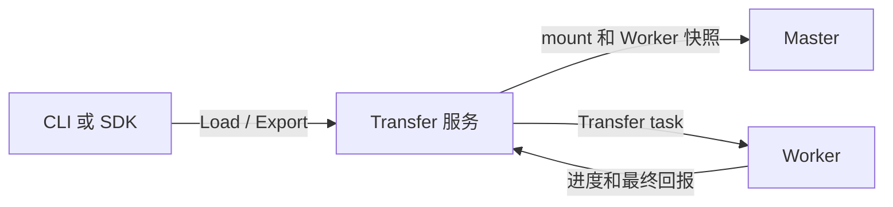

# Transfer 服务

所有 Load 和 Export 任务都由 Transfer 执行。它保存任务状态，基于 mount 和 Worker
信息规划任务，向 Worker 下发任务并接收回报。它不会保存完整 Curvine 元数据树的副本。



## 嵌入模式与独立模式

`[transfer]` 段决定服务运行的位置：

| 模式 | 选择方式 | 运行位置 | Job 存储 |
| --- | --- | --- | --- |
| 嵌入模式（默认） | 未配置 `endpoints` | 运行在 Leader Master 内，使用 Master 的 RPC 端口，日志写入 Master 日志 | Master 内存 |
| 独立模式 | 配置了 `endpoints`（可同时设置 `mode = "standalone"`） | 一个或多个单独的 `curvine-transfer` 进程 | 单实例用 SQLite，多实例用共享的 MySQL 或 PostgreSQL 数据库 |

集群无需部署 Transfer，也无需任何 `[transfer]` 配置：使用默认配置时，`cv load`、
`cv export` 和 `cv transfer` 通过 `[client]` 中的 Master 地址访问嵌入的服务。当任务
状态需要保存在数据库中，或希望 Transfer 规划在 Master 之外运行时，再部署独立服务。

## 独立服务的配置

| 组件 | 必需变更 | 说明 |
| --- | --- | --- |
| Transfer 服务 | `endpoints`、持久化 `store_url`，以及集群的 `[client]` Master 地址。 | `endpoints` 是客户端访问的地址，可以与 `hostname` 不同，例如经过负载均衡。 |
| Master | 相同的 `endpoints`。 | 配置后 Master 不再运行嵌入的 Transfer，它自己提交的任务（例如 fs 模式回写）也会发给该服务。未配置时 Master 继续运行嵌入服务。 |
| CLI、SDK 和 FUSE 客户端 | 相同的 `endpoints`。 | 未配置的客户端会把请求发给 Master；Master 配置为独立模式后会拒绝这些请求（“transfer RPC is not served by this master”）。 |
| Worker | 无。 | 回报 endpoint 随任务下发。 |

客户端配置中不需要数据库 URL。状态存储只属于 Transfer 服务端。

## 选择状态存储

| Store | 拓扑 | 适用场景 |
| --- | --- | --- |
| SQLite | 一个 Transfer 实例和一个持久化本地卷。 | 评估、开发或单实例部署。 |
| MySQL | 两个及以上 Transfer 实例共享同一个数据库。 | 生产高可用和滚动升级。 |

不要让多个 Transfer 实例使用彼此独立的 SQLite 文件。它们会持有不同的 Job 状态，无法
正确故障切换。

嵌入服务始终使用内存存储，并在启动时拒绝其他 `store_url`，因此未配置 `endpoints` 的
配置中不能设置 `store_url`。

## 必填配置

Transfer 服务端需要一份完整的集群配置，其中包括 `[client]` 的 Master 地址，以及以下
段落：

```toml
[transfer]
store_url = "sqlite:///var/lib/curvine-transfer/transfer.db"
hostname = "transfer-1.example.com"
endpoints = ["transfer-1.example.com:9010"]
```

使用 MySQL 时，将 `store_url` 改为共享的 MySQL URL。不要在客户端配置或 ConfigMap
中写入数据库凭据。

Master 和客户端只需要地址：

```toml
[transfer]
endpoints = ["transfer-1.example.com:9010"]
```

Curvine 不再根据 `hostname:rpc_port` 推导 endpoint：未配置 `endpoints` 的进程使用
嵌入模式，而设置了 `mode = "standalone"` 却未配置 `endpoints` 会校验失败。

## 部署与验证

- [物理机部署](./1-Bare-Metal.md)
- [Kubernetes 部署](./2-Kubernetes.md)
- [Transfer 配置参考](../2-Deploy-Curvine-Cluster/3-Distributed-Mode/03-conf.md#transfer)

部署后，在配置了相同 `endpoints` 的客户端执行 `cv transfer list`。再对一个小型已挂载
UFS 文件执行 `cv load <path> --watch`，确认任务进入 `Completed`，并使用
`cv fs --cache-only get` 读取目标。

## 切换模式

在嵌入模式和独立模式之间切换时，需要同时修改 Master、Transfer 和客户端配置中的
`[transfer]`，并重启这些进程。内存存储与独立存储之间不会复制 Job 记录，因此请先等待
运行中的任务结束（`cv transfer list --state running`）。存在运行中任务时，不要删除
Transfer Store。
