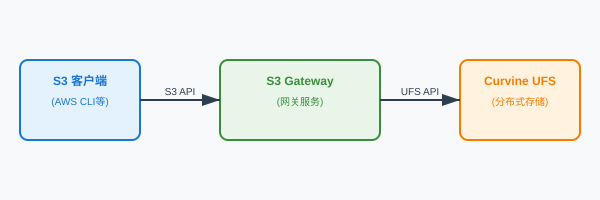

# S3 对象存储网关

Curvine S3 网关通过 S3 兼容的 HTTP API 暴露 Curvine 集群。已经支持 S3 协议的工具——AWS CLI、MinIO Client、boto3 或任意 S3 SDK——无需 FUSE 或 Curvine 原生客户端即可读写 Curvine 路径。网关使用 AWS Signature V2/V4 对每个请求进行认证，并将 bucket 和 key 映射为 Curvine 文件系统操作。

:::info
网关是一个可选的独立服务，不由 `curvine-server` 启动，目前也尚未包含在默认发行包中。请显式构建 `cargo build --release --bin curvine-s3-gateway`，并将其与 Curvine 集群一起运行。
:::

## 概述

S3 请求进入网关后，先通过凭据存储完成认证，再经由 Curvine 客户端执行。对象数据以流式方式在网关与 Curvine Worker 之间传输，不会将整个对象缓存在内存中。

### 主要特性

- S3 兼容的 bucket 和对象 API（见 [支持的 S3 操作](#支持的-s3-操作)）
- 使用 AWS Signature V2/V4 认证，支持本地或 Curvine 托管的凭据存储
- 支持 HTTP Range 请求，返回 `206 Partial Content`
- 支持大对象分片上传
- 流式读写
- 支持独立部署，并可通过负载均衡横向扩展

### 架构说明

S3 网关是 S3 API 客户端的前端，负责将 S3 请求转换为 Curvine 文件系统操作：



## 支持的 S3 操作

### Bucket 操作

| 操作 | HTTP 请求 |
| --- | --- |
| `CreateBucket` | `PUT /{bucket}` |
| `HeadBucket` | `HEAD /{bucket}` |
| `DeleteBucket` | `DELETE /{bucket}` |
| `ListBuckets` | `GET /` |
| `GetBucketLocation` | `GET /{bucket}?location` |

### 对象操作

| 操作 | HTTP 请求 |
| --- | --- |
| `PutObject` | `PUT /{bucket}/{key}` |
| `GetObject` | `GET /{bucket}/{key}` |
| `HeadObject` | `HEAD /{bucket}/{key}` |
| `DeleteObject` | `DELETE /{bucket}/{key}` |
| `ListObjectsV2` | `GET /{bucket}?list-type=2` |
| `DeleteObjects`（批量） | `POST /{bucket}?delete` |

### 分片上传

| 操作 | HTTP 请求 |
| --- | --- |
| `CreateMultipartUpload` | `POST /{bucket}/{key}?uploads` |
| `UploadPart` | `PUT /{bucket}/{key}?partNumber={n}&uploadId={id}` |
| `CompleteMultipartUpload` | `POST /{bucket}/{key}?uploadId={id}` |

:::note
`CopyObject` 和 `AbortMultipartUpload` 尚未实现，`ListObjectsV2` 也不支持分页。详见 [限制](#限制)。
:::

## 路径映射

网关将 S3 路径直接映射到 Curvine 命名空间，不添加额外前缀：

| S3 路径 | Curvine 路径 |
| --- | --- |
| Bucket `my-bucket` | `/my-bucket` |
| 对象 `my-bucket/folder/file.txt` | `/my-bucket/folder/file.txt` |

Bucket 就是普通的 Curvine 目录，对象就是普通文件。上传对象前必须先创建 bucket；也可以通过 FUSE、CLI 或 SDK 访问这些路径。

## 快速开始

### 1. 构建网关

```bash
cargo build --release --bin curvine-s3-gateway
```

二进制文件输出到 `target/release/curvine-s3-gateway`。发行包目前尚未包含该二进制，请从构建输出目录运行，或将其复制到网关所在机器。

### 2. 配置集群连接

网关复用常规的 Curvine 集群配置文件。为网关相关设置添加 `[s3_gateway]` 部分；`[client]`、`[master]` 等其他部分用于连接集群：

```toml
[s3_gateway]
listen = "0.0.0.0:9900"
region = "us-east-1"
put_temp_dir = "/tmp/curvine-temp"
```

所有选项见 [配置](#配置)。

### 3. 创建凭据

网关没有内置的默认凭据。请生成密钥对并写入凭据存储：

```bash
target/release/curvine-s3-gateway credential generate --description "local test"
```

或注册已有的密钥对（access key 长度必须为 16–32 个字符，secret key 为 16–64 个字符）：

```bash
target/release/curvine-s3-gateway credential add \
    --access-key "$ACCESS_KEY" \
    --secret-key "$SECRET_KEY" \
    --description "application A"
```

以上命令使用配置文件所选的凭据存储。详见 [凭据管理](#凭据管理)。

### 4. 启动网关

```bash
target/release/curvine-s3-gateway --conf etc/curvine-cluster.toml
```

默认监听地址为 `0.0.0.0:9900`。可以在命令行覆盖监听地址和 region：

```bash
target/release/curvine-s3-gateway \
    --conf etc/curvine-cluster.toml \
    --listen 0.0.0.0:9000 \
    --region us-west-2
```

:::note
仅当 `--listen` 和 `--region` 的取值不同于内置默认值（`0.0.0.0:9900` 和 `us-east-1`）时，它们才会覆盖配置文件中的值。这两个值请使用配置文件设置，或在命令行显式传入不同的值。
:::

### 5. 验证

```bash
curl http://localhost:9900/healthz
# ok
```

## 配置

### 命令行参数

| 参数 | 描述 | 默认值 |
| --- | --- | --- |
| `--conf` | Curvine 集群配置文件 | `etc/curvine-cluster.toml` |
| `--listen` | 监听地址（`host:port`） | `0.0.0.0:9900` |
| `--region` | S3 region 标识 | `us-east-1` |
| `--credentials-path` | 覆盖凭据存储路径 | `[s3_gateway]` 中的值 |
| `serve` | 可选子命令；不带子命令时直接启动服务 | — |
| `credential add\|generate\|list\|stats` | 凭据管理子命令 | — |

### `[s3_gateway]` 配置

| 参数 | 类型 | 默认值 | 描述 |
| --- | --- | --- | --- |
| `listen` | string | `"0.0.0.0:9900"` | 监听地址和端口 |
| `region` | string | `"us-east-1"` | S3 region 标识 |
| `put_temp_dir` | string | `"/tmp/curvine-temp"` | 本地存储模式下 PUT 操作（普通上传和分片上传）的临时目录 |
| `put_memory_buffer_threshold` | integer | `1048576` | PUT 时小于该大小（字节）的对象缓存在内存中 |
| `put_max_memory_buffer` | integer | `16777216` | PUT 时内存缓冲区的最大大小（字节） |
| `get_chunk_size_mb` | float | `1.0` | GET 响应的读写块大小（MB） |
| `enable_distributed_auth` | boolean | `false` | 将凭据存储在 Curvine 中，而不是本地文件系统 |
| `credentials_path` | string | 见下文 | 凭据存储路径 |
| `cache_refresh_interval_secs` | integer | `30` | 凭据缓存刷新间隔（秒） |

`[worker]` 部分的 `worker.enable_s3_gateway` 用于启用分布式分片存储：分片数据写入 Curvine 的 `/.s3temp`，而不是 `put_temp_dir`，因此任意网关实例都可以完成上传。设置该项也会使二进制切换到分布式凭据存储。

**凭据存储路径：**

- 本地模式（`enable_distributed_auth = false`）：默认 `~/.curvine/credentials.jsonl`
- 分布式模式（`enable_distributed_auth = true`）：默认 `/system/auth/credentials.jsonl`

**配置示例：**

```toml
[s3_gateway]
# S3 API 监听地址（host:port）
listen = "0.0.0.0:9900"

# 返回给客户端的 S3 region
region = "us-east-1"

# PUT 和分片上传的临时目录（本地存储模式）
put_temp_dir = "/tmp/curvine-temp"

# PUT 时小于该大小（字节）的对象缓存在内存中
put_memory_buffer_threshold = 1048576

# PUT 时内存缓冲区的最大大小（字节）
put_max_memory_buffer = 16777216

# GET 读写块大小（MB）
get_chunk_size_mb = 1.0

# 本地凭据存储（默认）
enable_distributed_auth = false
credentials_path = "~/.curvine/credentials.jsonl"

# 分布式凭据存储
# enable_distributed_auth = true
# credentials_path = "/system/auth/credentials.jsonl"

# 凭据缓存刷新间隔（秒）
cache_refresh_interval_secs = 30
```

## 凭据管理

凭据以 JSONL 格式存储，每行一个条目：

```json
{"access_key":"AKIA...","secret_key":"...","created_at":1735689600,"enabled":true,"description":"application A"}
```

### 环境变量

| 变量 | 描述 |
| --- | --- |
| `AWS_ACCESS_KEY_ID` 或 `CURVINE_ACCESS_KEY` | Access key |
| `AWS_SECRET_ACCESS_KEY` 或 `CURVINE_SECRET_KEY` | Secret key |
| `RUST_LOG` | 日志级别（例如 `info`、`debug`、`curvine_s3_gateway::auth=debug`） |

仅当配置的凭据存储为空时，网关才会导入环境变量中的凭据；导入的密钥对会写入本地凭据存储。如果既没有已存储的凭据，也没有环境变量凭据，网关将以空存储启动，并拒绝所有请求。

### 命令

```bash
# 生成随机密钥对并打印
target/release/curvine-s3-gateway credential generate --description "test key"

# 注册已有密钥对
target/release/curvine-s3-gateway credential add \
    --access-key "$ACCESS_KEY" \
    --secret-key "$SECRET_KEY" \
    --description "application A"

# 列出凭据（隐藏 secret）
target/release/curvine-s3-gateway credential list

# 列出凭据（包含 secret）
target/release/curvine-s3-gateway credential list --show-secrets

# 查看凭据缓存统计
target/release/curvine-s3-gateway credential stats
```

:::warning
`credential list --show-secrets` 和 `credential generate` 会将 secret key 打印到终端。请将该输出视为敏感信息，避免写入 shell 历史或共享日志。
:::

## 使用示例

以下示例使用 `AWS_ACCESS_KEY_ID` 和 `AWS_SECRET_ACCESS_KEY`。请先导出在 [快速开始](#快速开始) 中创建的密钥对：

```bash
export AWS_ACCESS_KEY_ID="$ACCESS_KEY"
export AWS_SECRET_ACCESS_KEY="$SECRET_KEY"
export AWS_DEFAULT_REGION=us-east-1
```

### AWS CLI

```bash
# 创建 bucket
aws s3 mb s3://my-bucket --endpoint-url http://localhost:9900

# 上传文件
aws s3 cp /path/to/local/file.txt s3://my-bucket/ --endpoint-url http://localhost:9900

# 下载文件
aws s3 cp s3://my-bucket/file.txt /tmp/ --endpoint-url http://localhost:9900

# 列出对象
aws s3 ls s3://my-bucket/ --endpoint-url http://localhost:9900

# 删除对象
aws s3 rm s3://my-bucket/file.txt --endpoint-url http://localhost:9900

# 删除 bucket
aws s3 rb s3://my-bucket --endpoint-url http://localhost:9900

# 同步目录
aws s3 sync /local/directory s3://my-bucket/prefix/ --endpoint-url http://localhost:9900
```

### MinIO Client (mc)

```bash
mc alias set curvine http://localhost:9900 "$AWS_ACCESS_KEY_ID" "$AWS_SECRET_ACCESS_KEY"

mc mb curvine/my-bucket
mc cp /path/to/file.txt curvine/my-bucket/
mc cp curvine/my-bucket/file.txt /tmp/
mc ls curvine/my-bucket/
mc mirror /local/directory curvine/my-bucket/prefix/
```

### Python boto3

```python
import os
import boto3

s3_client = boto3.client(
    's3',
    endpoint_url='http://localhost:9900',
    aws_access_key_id=os.environ['AWS_ACCESS_KEY_ID'],
    aws_secret_access_key=os.environ['AWS_SECRET_ACCESS_KEY'],
    region_name='us-east-1',
)

s3_client.create_bucket(Bucket='my-python-bucket')

with open('local-file.txt', 'rb') as f:
    s3_client.put_object(Bucket='my-python-bucket', Key='remote-file.txt', Body=f)

response = s3_client.get_object(Bucket='my-python-bucket', Key='remote-file.txt')
data = response['Body'].read()

response = s3_client.list_objects_v2(Bucket='my-python-bucket')
for obj in response.get('Contents', []):
    print(f"Object: {obj['Key']}, Size: {obj['Size']}")
```

### Range 请求

```bash
# 前 1000 字节
curl -H "Range: bytes=0-999" \
     -H "Authorization: AWS4-HMAC-SHA256 ..." \
     http://localhost:9900/my-bucket/file.txt

# 最后 1000 字节
curl -H "Range: bytes=-1000" \
     -H "Authorization: AWS4-HMAC-SHA256 ..." \
     http://localhost:9900/my-bucket/file.txt
```

Range 响应使用状态码 `206`，并包含 `Content-Range` 头。签名请求最简单的生成方式是使用 S3 SDK 或 AWS CLI。

### 分片上传

```bash
# 初始化上传
aws s3api create-multipart-upload \
    --bucket my-bucket \
    --key large-file.zip \
    --endpoint-url http://localhost:9900

# 上传分片
aws s3api upload-part \
    --bucket my-bucket \
    --key large-file.zip \
    --part-number 1 \
    --upload-id "$UPLOAD_ID" \
    --body part1.bin \
    --endpoint-url http://localhost:9900

# 完成上传
aws s3api complete-multipart-upload \
    --bucket my-bucket \
    --key large-file.zip \
    --upload-id "$UPLOAD_ID" \
    --multipart-upload file://parts.json \
    --endpoint-url http://localhost:9900
```

:::note
`AbortMultipartUpload` 尚未路由，因此放弃的上传会在临时存储目录中留下分片，需要手动清理。
:::

## 部署

### 单实例

请通过进程管理工具（systemd、supervisor、Kubernetes）运行该二进制。目前尚未提供 start/stop 脚本：

```ini
[Unit]
Description=Curvine S3 Gateway
After=network.target

[Service]
ExecStart=/opt/curvine/bin/curvine-s3-gateway --conf /opt/curvine/conf/curvine-cluster.toml
Restart=on-failure
Environment=RUST_LOG=info

[Install]
WantedBy=multi-user.target
```

### 多实例

除临时分片数据和凭据外，网关是无状态的，因此可以部署在负载均衡之后：

```nginx
upstream s3_gateway {
    server 192.168.1.10:9900 weight=1;
    server 192.168.1.11:9900 weight=1;
    server 192.168.1.12:9900 weight=1;
}

server {
    listen 80;
    server_name s3-gateway.example.com;

    location / {
        proxy_pass http://s3_gateway;
        proxy_set_header Host $host;
        proxy_set_header X-Real-IP $remote_addr;
        proxy_set_header X-Forwarded-For $proxy_add_x_forwarded_for;

        proxy_buffering off;
        proxy_request_buffering off;
        client_max_body_size 0;
    }
}
```

当网关实例多于一个时，请启用分布式分片存储和分布式凭据，使任意实例都能完成上传：

```toml
[s3_gateway]
enable_distributed_auth = true

[worker]
enable_s3_gateway = true
```

如果未启用分布式存储，分片会保留在接收该分片的实例本地 `put_temp_dir` 中；路由到其他实例的 `CompleteMultipartUpload` 将找不到这些分片。另一种方式是在负载均衡上配置会话保持。

### 健康检查

```bash
curl http://localhost:9900/healthz
# ok
```

## 监控与日志

网关通过 `tracing` 将日志输出到 stdout。可以使用 `RUST_LOG` 调整日志级别：

```bash
# 常规调试
export RUST_LOG=curvine_s3_gateway=debug

# 认证调试
export RUST_LOG=curvine_s3_gateway::auth=debug

# 所有日志（非常详细）
export RUST_LOG=trace
```

日志覆盖请求处理、认证失败、分片操作和文件系统错误。目前没有 metrics 端点；请使用 `/healthz` 端点进行存活检查。

## 限制

- 未实现 `CopyObject`；客户端需要先下载再重新上传。
- 未实现 `AbortMultipartUpload`；放弃的上传会遗留临时分片。
- `ListObjectsV2` 只返回单页：`continuation-token` 和 `max-keys` 会被忽略，`is-truncated` 始终为 `false`。
- 接受条件请求头（`If-Match`、`If-None-Match`），但不会对其进行判断。
- 启用 Curvine 回收站时，`DeleteObject` 和 `DeleteBucket` 会将数据移入回收站，而不是永久删除。

## 故障排除

### 端口被占用

修改 `[s3_gateway]` 中的监听地址，或传入不同的 `--listen` 值：

```bash
target/release/curvine-s3-gateway --conf etc/curvine-cluster.toml --listen 0.0.0.0:9901
```

### 认证失败

```bash
# 检查环境变量
echo "$AWS_ACCESS_KEY_ID"
echo "$AWS_SECRET_ACCESS_KEY"

# 检查凭据存储
target/release/curvine-s3-gateway credential list
target/release/curvine-s3-gateway credential stats

# 开启认证日志
export RUST_LOG=curvine_s3_gateway::auth=debug
```

### 配置文件错误

如果配置文件无法加载，网关会打印警告并继续使用默认配置。请检查路径和 TOML 语法：

```bash
target/release/curvine-s3-gateway --conf /path/to/curvine-cluster.toml
```

### Bucket 不存在

上传前请先创建 bucket（`aws s3 mb`），网关不会隐式创建 bucket。

### 连通性检查

```bash
curl -v http://localhost:9900/healthz
netstat -tlnp | grep 9900
```

## 性能调优

```bash
# 提高文件描述符上限
ulimit -n 65536

# TCP 和 socket 缓冲区调优
echo 'net.ipv4.tcp_keepalive_time = 600' >> /etc/sysctl.conf
echo 'net.core.rmem_max = 16777216' >> /etc/sysctl.conf
echo 'net.core.wmem_max = 16777216' >> /etc/sysctl.conf
sysctl -p
```

对于大对象场景，可以提高 `get_chunk_size_mb`，并确保 `put_temp_dir` 位于快速本地存储上。当 `worker.enable_s3_gateway = true` 时，分片会直接写入 Curvine，不会使用 `put_temp_dir`。
